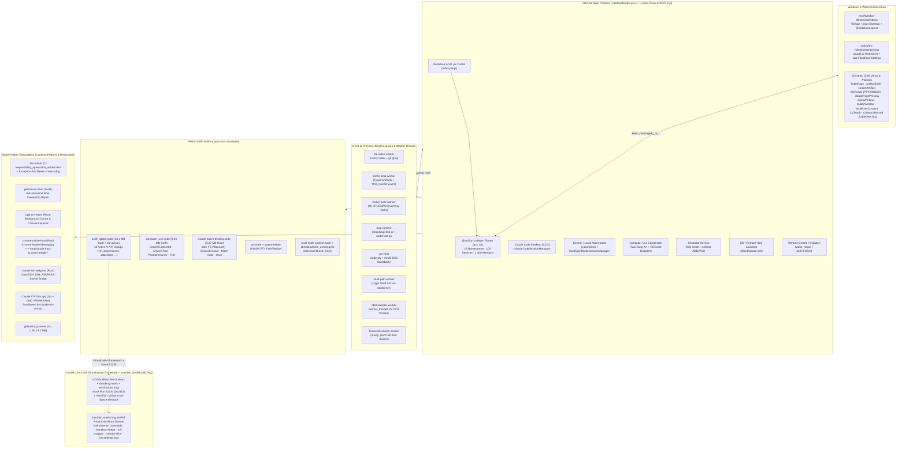

# Claude.app (`@ant/desktop` v3.6556.2) — Complete Architecture Specification

- **Target Artifact:** `~/Downloads/Claude.dmg` (`sha256: a1635179eb3574988202d89d6c1929a7a4238d7b302409301b69e81c8ec3efd5`, mounted at `/Volumes/Claude/Claude.app`)
- **Extracted ASAR Workspace:** `/Users/eric/quixi-desk/asar-extracted`
- **Package Name & Version:** `@ant/desktop` `3.6556.2` (`CFBundleIdentifier`: `com.anthropic.claudefordesktop`)
- **Build Commit (`buildCommit`):** `20c019a1e61fa5b687616af57d31f97bb3181723` (`2026-10-22T22:38:18.000Z`)
- **Runtime Stack:** Electron `44.9.3` · Chromium `152.0.7977.167` · Node.js `v24.22.0` · macOS SDK `15.5` (`Xcode 16.4`)

---

## 1. High-Level System Architecture



---

## 2. Application Bundle Layout, Signing & Security Posture

### 2.1 `Contents/Info.plist` & Registered Types
- **Bundle Identifier:** `com.anthropic.claudefordesktop` (`TeamIdentifier`: `Q6L2SF6YDW`, Anthropic PBC)
- **Minimum macOS Version:** `13.0` (`LSMinimumSystemVersion`)
- **Principal Class:** `AtomApplication`
- **Process Environment:** `LSEnvironment = { MallocNanoZone = "0" }`
- **App Transport Security:** `NSAllowsArbitraryLoads = false`, `NSAllowsLocalNetworking = true`
- **URL Schemes (`CFBundleURLTypes`):**
  1. `claude://` (`CFBundleURLName = "Claude"`)
  2. `msauth.com.anthropic.claudefordesktop://` (`CFBundleURLName = "MSAL"`, Microsoft Entra / Office 365 broker callback)
- **Custom UTIs & File Associations:**
  - **Desktop Extensions:** `.dxt`, `.mcpb` (`dxt.icns`)
  - **Claude Skill Archives:** `.skill` (exported UTI `com.anthropic.skill`, conforms to `public.data`, `public.zip-archive`)
  - **Viewer / Editor Associations:** Folders (`public.folder`), Markdown (`net.daringfireball.markdown`), PDF, DOCX/DOC, RTF, ODT, EPUB, source code/scripts/JSON/YAML/CSV, and PNG/JPEG/GIF/WebP.
- **ASAR Integrity Pin (`ElectronAsarIntegrity`):**
  - `Resources/app.asar` SHA-256 pinned in `Info.plist`: `0c5f1f25e58a6d7d696058f0346f0e00066b8669351d41d3879f1ddee3f2982a`.

### 2.2 Code Signature Entitlements & Provisioning Profile
`Contents/MacOS/Claude` is signed with Hardened Runtime (`flags=0x10000(runtime)`) and embeds `Contents/embedded.provisionprofile` (`UUID: 7ecaa873-983d-4f9b-a2af-90079e8f7261`). Its entitlements are:
- `com.apple.application-identifier`: `Q6L2SF6YDW.com.anthropic.claudefordesktop`
- `com.apple.developer.team-identifier`: `Q6L2SF6YDW`
- `com.apple.security.virtualization`: `true` (required for `Virtualization.framework` / `VZVirtualMachine`)
- `com.apple.security.automation.apple-events`: `true`
- `com.apple.security.cs.allow-jit`: `true`
- `com.apple.security.device.{audio-input, bluetooth, camera, print, usb}`: `true`
- `com.apple.security.personal-information.{location, photos-library}`: `true`
- `keychain-access-groups`:
  - `Q6L2SF6YDW.com.anthropic.claude.webauthn`
  - `Q6L2SF6YDW.com.anthropic.claude.hwkey` (Secure Enclave non-exportable signing key)
  - `Q6L2SF6YDW.com.microsoft.identity.universalstorage`
  - `Q6L2SF6YDW.com.microsoft.workplacejoin`
  - `Q6L2SF6YDW.com.microsoft.workplacejoin.v2`

### 2.3 Electron Fuse Configuration
Inspected directly from `Electron Framework` sentinel `dL7pKGdnNz796PbbjQWNKmHXBZaB9tsX` (Version `1`, wire `010011011`):

| Fuse Index | Fuse Name | State | Architectural Effect |
|---:|---|---|---|
| `0` | `RunAsNode` | **DISABLED (`0`)** | Blocks `ELECTRON_RUN_AS_NODE=1` abuse at the binary level; local JS MCP servers instead run inside `utilityProcess` (`mcp-runtime/nodeHost.js`). |
| `1` | `EnableCookieEncryption` | **ENABLED (`1`)** | Encrypts Chromium `Cookies` SQLite store via OS Keychain. |
| `2` | `EnableNodeOptionsEnvironmentVariable` | **DISABLED (`0`)** | Ignores `NODE_OPTIONS` in the environment. |
| `3` | `EnableNodeCliInspectArguments` | **DISABLED (`0`)** | Blocks `--inspect` / `--inspect-brk` attach flags. |
| `4` | `EnableEmbeddedAsarIntegrityValidation` | **ENABLED (`1`)** | Verifies `Resources/app.asar` header SHA-256 against `Info.plist` on boot. |
| `5` | `OnlyLoadAppFromAsar` | **ENABLED (`1`)** | Prevents loading unpacked `Resources/app` overrides. |
| `6` | `LoadBrowserProcessSpecificV8Snapshot` | **DISABLED (`0`)** | Uses custom `.jsc` V8 bytecode compile cache instead (see §3.1). |
| `7` | `GrantFileProtocolExtraPrivileges` | **ENABLED (`1`)** | Grants `file://` renderer frames privileges where used. |
| `8` | `WasmTrapHandlers` | **ENABLED (`1`)** | Enables hardware out-of-bounds WebAssembly trap handlers. |

---

## 3. Electron Main Process & Bootstrap Architecture

### 3.1 Startup Pipeline (`index.pre.js` $\to$ `index.js` $\to$ `index.chunk-jPKPzV-P.js`)
1. **[`.vite/build/index.pre.js`](file:///Users/eric/quixi-desk/asar-extracted/.vite/build/index.pre.js) (982,086 B):**
   - **CLI & Anti-Debugging Gate (`nZ()`):** Handles `--version` immediately. Sets `process.env.NoDefaultCurrentDirectoryInExePath = "1"`. In packaged builds (`!EZ()`), checks for forbidden Chromium/Node debugging or network-override flags (`--inspect`, `--remote-debugging-port`, `--host-resolver-rules`, etc.) and exits with code `1` unless developer mode is authorized.
   - **Chromium Feature Flags:** Appends `enable-features=IsolatesPriorityUseProcessPriority`, `dnsPrefetchingEnabled=false`, and `disable-features=ConnectionAllowlists`.
   - **V8 Bytecode Compile Cache (`Fte()` / `Ite()` & [`compile-cache/`](file:///Users/eric/quixi-desk/asar-extracted/compile-cache)):**
     - Ships pre-compiled V8 bytecode snapshots (`.jsc`) for both `arm64` and `x64`:
       - `index.js.{arm64,x64}.jsc` (~2.7 KB)
       - `index.chunk-BjdXj7EG.js.{arm64,x64}.jsc` (~3.7 KB)
       - `index.chunk-jPKPzV-P.js.{arm64,x64}.jsc` (~9.6 MB)
     - Monkey-patches `Module.prototype._compile`: whenever a module in `.vite/build/` is loaded and a matching `<basename>.<process.arch>.jsc` file exists in `compile-cache/`, it passes `cachedData` into `new vm.Script(Module.wrap(content), { filename, cachedData })`, bypassing JS parsing/compilation for the 6.7 MB core bundle.
     - Records cache hit status on `globalThis.__claudeMainCompileCache` (`"hit" | "partial" | "miss"`).
     - During build packaging, passing `CLAUDE_GENERATE_COMPILE_CACHE=<token>` (matching `compile-cache/.generate-token`) runs `Ite()` to generate the `.jsc` snapshots and exit.
   - **Enterprise / MDM Configuration & HIPAA Guard:**
     - Reads managed enterprise policy from macOS Managed Preferences (`com.anthropic.claudefordesktop` plist via `@ant/claude-native` `readPlistValue`), Windows GPO Registry (`SOFTWARE\Policies\Anthropic\Claude`), or Linux `/etc/claude-desktop/managed-settings.json`.
     - If `coworkHipaaRestricted` is enabled, purges all Crashpad `.dmp` files from `Crashpad/{completed,pending,new,reports}` prior to initializing `@sentry/electron/main`.
2. **[`.vite/build/index.js`](file:///Users/eric/quixi-desk/asar-extracted/.vite/build/index.js) (638 B) & [`index.chunk-BjdXj7EG.js`](file:///Users/eric/quixi-desk/asar-extracted/.vite/build/index.chunk-BjdXj7EG.js) (1,290 B):**
   - Sets `globalThis.SENTRY_RELEASE` (`20c019a1e61fa5b687616af57d31f97bb3181723`), loads Rolldown CJS runtime helpers (`index.chunk-BjdXj7EG.js`), and requires `index.chunk-jPKPzV-P.js`.
3. **[`.vite/build/index.chunk-jPKPzV-P.js`](file:///Users/eric/quixi-desk/asar-extracted/.vite/build/index.chunk-jPKPzV-P.js) (6,726,036 B, 3,728 exported bindings):**
   - Registers custom privileged schemes (`app://` and `cowork-artifact://`), acquires `app.requestSingleInstanceLock()`, registers all 102 `@ant/ipc-codegen` services, creates `mainWindow` and `mainView`, initializes `@ant/claude-swift`, and lazily loads the remaining 462 `index.chunk-*.js` modules on demand.

### 3.2 Domain Map of the 464 `.vite/build/index.chunk-*.js` Bundles
The complete 464-chunk dependency & symbol map is saved in [reference/vite-chunks-464-map.txt](file:///Users/eric/quixi-desk/reference/vite-chunks-464-map.txt). Key subsystem chunks:

| Subsystem Domain | Primary Chunk Files | Core Responsibilities |
|---|---|---|
| **Core Main Process** | [`index.chunk-jPKPzV-P.js`](file:///Users/eric/quixi-desk/asar-extracted/.vite/build/index.chunk-jPKPzV-P.js) (6.73 MB) | Lifecycle, `mainWindow` + `mainView`, IPC router (`go`/`Xtt`), tray (`CGa`), protocols (`app://`, `cowork-artifact://`), VM client wrapper (`xLn`), Computer Use host adapter (`SGi`), DXT/MCP orchestration, OAuth/MSAL, telemetry. |
| **Claude Code Desktop (CCD)** | [`index.chunk-DNPOm2Zc.js`](file:///Users/eric/quixi-desk/asar-extracted/.vite/build/index.chunk-DNPOm2Zc.js) (2.29 MB), [`index.chunk-XMjxLyvj.js`](file:///Users/eric/quixi-desk/asar-extracted/.vite/build/index.chunk-XMjxLyvj.js) (354 KB), [`index.chunk-DwpWau9w.js`](file:///Users/eric/quixi-desk/asar-extracted/.vite/build/index.chunk-DwpWau9w.js) (54 KB), [`index.chunk-BOo3PhEk.js`](file:///Users/eric/quixi-desk/asar-extracted/.vite/build/index.chunk-BOo3PhEk.js) (45 KB) | `claudeCodeSessionManager`: manages local/SSH Claude Code CLI sessions, git worktree pool (`createWorktreePool`), diff/PR watching, `AutoFixEngine` (automated CI/PR fixing), `AutoArchiveEngine`, `CLAUDE.md` discovery, `agent-registry.json`. |
| **Bundled Claude Agent SDK & CCR Bridge** | [`index.chunk-0EQutPPD.js`](file:///Users/eric/quixi-desk/asar-extracted/.vite/build/index.chunk-0EQutPPD.js) (1.27 MB), [`index.chunk-gMUTWD54.js`](file:///Users/eric/quixi-desk/asar-extracted/.vite/build/index.chunk-gMUTWD54.js) (951 KB), [`index.chunk-CaMfgPde.js`](file:///Users/eric/quixi-desk/asar-extracted/.vite/build/index.chunk-CaMfgPde.js) (331 KB) | Lazy-loaded `@anthropic-ai/claude-agent-sdk` (`v0.3.308`), CCR/Agent bridge, and `@anthropic-ai/sdk` API client. |
| **Shared Session / Tool / MCP Coordinator** | [`index.chunk-DBIg6EBr.js`](file:///Users/eric/quixi-desk/asar-extracted/.vite/build/index.chunk-DBIg6EBr.js) (788 KB) | Shared session orchestration across `claudeCodeSessionManager` and `localAgentModeSessionManager`: MCP attachment, tool permissions, Computer Use tool wiring, Halo/Slack/GitHub integration, transcripts. |
| **Cowork / Local Agent Mode (`yukonSilver`)** | [`index.chunk-Dl8NPgw7.js`](file:///Users/eric/quixi-desk/asar-extracted/.vite/build/index.chunk-Dl8NPgw7.js) (625 KB), [`index.chunk-DvC_ywN_.js`](file:///Users/eric/quixi-desk/asar-extracted/.vite/build/index.chunk-DvC_ywN_.js) (152 KB), [`index.chunk-BtY4LlaK.js`](file:///Users/eric/quixi-desk/asar-extracted/.vite/build/index.chunk-BtY4LlaK.js) (104 KB), [`index.chunk-DaIKVO-Q.js`](file:///Users/eric/quixi-desk/asar-extracted/.vite/build/index.chunk-DaIKVO-Q.js) (15 KB) | `localAgentModeSessionManager`, `createLocalAgentModeSessionsApi`, `createCoworkStorageApi`: manages Cowork sessions in the Linux VM or host-loop mode, VirtioFS folder mounts, `cowork_memory_sync`, document funnel, and scheduled tasks. |
| **Imagine / Design Canvas Server** | [`index.chunk-CbnfBP-3.js`](file:///Users/eric/quixi-desk/asar-extracted/.vite/build/index.chunk-CbnfBP-3.js) (468 KB) | `getImagineServerDef` (`@ant/imagine-server`): in-process MCP server and canvas state engine for interactive design generation (`EngineSurface` IPC). |
| **SSH Remote Sessions (`@ant/claude-ssh`)** | [`index.chunk-DiYrspRo.js`](file:///Users/eric/quixi-desk/asar-extracted/.vite/build/index.chunk-DiYrspRo.js) (383 KB), [`index.chunk-CPNJ_7Qs.js`](file:///Users/eric/quixi-desk/asar-extracted/.vite/build/index.chunk-CPNJ_7Qs.js) (371 KB), [`index.chunk-CyQStuDv.js`](file:///Users/eric/quixi-desk/asar-extracted/.vite/build/index.chunk-CyQStuDv.js) (269 KB) | `SshRemoteHostLauncher`, `system-openssh` + `ssh2` transports, remote `claude.zst` deployment, port forwarding, master control socket, and reconnect state machine. |
| **Computer Use, Teach & Watch-Record** | [`index.chunk-Cgwbta3N.js`](file:///Users/eric/quixi-desk/asar-extracted/.vite/build/index.chunk-Cgwbta3N.js) (238 KB), [`index.chunk-DinDpVtd.js`](file:///Users/eric/quixi-desk/asar-extracted/.vite/build/index.chunk-DinDpVtd.js) (57 KB), [`index.chunk-_O4b7knL.js`](file:///Users/eric/quixi-desk/asar-extracted/.vite/build/index.chunk-_O4b7knL.js) (39 KB), [`index.chunk-sl5WQ71u.js`](file:///Users/eric/quixi-desk/asar-extracted/.vite/build/index.chunk-sl5WQ71u.js) (1.4 KB) | `ComputerUseCoordinator` (`computer_batch`, `request_teach_access`, `teach_step`), `initCuWatchRecord` (floating pill + window chooser + workflow recorder), and `SableOtterHud`. |
| **iOS & Android Simulator Integration** | [`index.chunk-BmVqj0dr.js`](file:///Users/eric/quixi-desk/asar-extracted/.vite/build/index.chunk-BmVqj0dr.js) (212 KB), [`index.chunk-CkWBmgBr.js`](file:///Users/eric/quixi-desk/asar-extracted/.vite/build/index.chunk-CkWBmgBr.js) (185 KB), [`index.chunk-2PlBOhx8.js`](file:///Users/eric/quixi-desk/asar-extracted/.vite/build/index.chunk-2PlBOhx8.js) (149 KB), [`index.chunk-FT1Y3ohY.js`](file:///Users/eric/quixi-desk/asar-extracted/.vite/build/index.chunk-FT1Y3ohY.js) (76 KB) | `SimulatorService`: controls Xcode `simctl`, `Claude iOS Sim.app`, `@ant/claude-sim-camera-helper`, and Android Emulator (`adb`, AVD provisioning, foldable hinge/posture controls, accessibility trees). |
| **Remote Control / Dispatch (`wake_helper`)** | [`index.chunk-DAns1s59.js`](file:///Users/eric/quixi-desk/asar-extracted/.vite/build/index.chunk-DAns1s59.js) (137 KB) | `initRemoteControlServe`: allows mobile/web `claude.ai` clients to remotely dispatch tasks to and watch the desktop app (`pollForWork`, `acknowledgeWork`, `watchSessions`, `mintSessionsResumeToken`). |
| **Skills, Plugins & Marketplace** | [`index.chunk-DVWJXMwL.js`](file:///Users/eric/quixi-desk/asar-extracted/.vite/build/index.chunk-DVWJXMwL.js) (100 KB), [`index.chunk-CiaVTkSf.js`](file:///Users/eric/quixi-desk/asar-extracted/.vite/build/index.chunk-CiaVTkSf.js) (95 KB), [`index.chunk-h5ilKUwe.js`](file:///Users/eric/quixi-desk/asar-extracted/.vite/build/index.chunk-h5ilKUwe.js) (89 KB) | Bundled & user skills sync (`SKILL.md`, `.skill` zips), `cowork_save_skill`, plugin marketplace installation, `tearOffHalo` / `sessionHalo` / `slackWatch` triggers. |
| **PTY Terminal Host & Shell Hooks** | [`index.chunk-hSh48Lyb.js`](file:///Users/eric/quixi-desk/asar-extracted/.vite/build/index.chunk-hSh48Lyb.js) (86 KB), [`index.chunk-B80dqaMC.js`](file:///Users/eric/quixi-desk/asar-extracted/.vite/build/index.chunk-B80dqaMC.js) (75 KB) | `PtyHostManager` and shell integration scripts (`claude-desktop.{zsh,bash,fish,ps1}`) emitting OSC 1337/633 prompt/command markers. |
| **Office Add-in & Dev Preview MCP** | [`index.chunk-CyvTc_q3.js`](file:///Users/eric/quixi-desk/asar-extracted/.vite/build/index.chunk-CyvTc_q3.js) (69 KB), [`index.chunk-CShY_DmK.js`](file:///Users/eric/quixi-desk/asar-extracted/.vite/build/index.chunk-CShY_DmK.js) (62 KB) | `initOfficeAddinBridge` (`wss://bridge.claudeusercontent.com`, PowerPoint/Excel/Word add-in) and Dev Preview MCP tools (`preview_start`, `preview_click`, `preview_eval`, `preview_inspect`, `preview_network`, `preview_screenshot`, `preview_snapshot`). |

---

## 4. Windows, `WebContentsView`s, Renderer Bundles & Preload Bridges

### 4.1 Two-Layer Window Architecture (`mainWindow` + `mainView`)
1. **`mainWindow` (`BrowserWindow`, type `Ri.MAIN_WINDOW`, created by `ZSe()`):**
   - Loads [`.vite/renderer/main_window/index.html`](file:///Users/eric/quixi-desk/asar-extracted/.vite/renderer/main_window/index.html) with preload [`.vite/build/mainWindow.js`](file:///Users/eric/quixi-desk/asar-extracted/.vite/build/mainWindow.js).
   - Renders the custom titlebar (`MainWindowTitleBar`), instant startup skeleton (`--desktop-boot-placeholder=` matching the user's saved sidebar width, theme, and active `"chat" | "cowork" | "code"` tab), and the offline error page containing the hidden 1.23 MB **`@ant/clawd-quest`** game ([`clawdQuestEngine-CLioUiZn.js`](file:///Users/eric/quixi-desk/asar-extracted/.vite/renderer/main_window/assets/clawdQuestEngine-CLioUiZn.js)).
2. **`mainView` (`WebContentsView`, type `Ri.CLAUDE_AI_WEB`, created by `QSe()`):**
   - Attached to `mainWindow.contentView` with preload [`.vite/build/mainView.js`](file:///Users/eric/quixi-desk/asar-extracted/.vite/build/mainView.js) (`contextIsolation: true, nodeIntegration: false, sandbox: true, webSecurity: true`).
   - Loads `https://claude.ai/...` (or enterprise 3P URL) and local settings/onboarding routes via `app://localhost/...`.
3. **Dynamic Child `WebContentsView`s & Auxiliary Windows:**
   - **Find-in-Page (`Ri.FIND_IN_PAGE`):** Preload [`findInPage.js`](file:///Users/eric/quixi-desk/asar-extracted/.vite/build/findInPage.js), loads [`.vite/renderer/find_in_page/find-in-page.html`](file:///Users/eric/quixi-desk/asar-extracted/.vite/renderer/find_in_page/find-in-page.html).
   - **Typed Artifact Shell (`Bla`):** Preload [`artifactShell.js`](file:///Users/eric/quixi-desk/asar-extracted/.vite/build/artifactShell.js), loads `cowork-artifact://shell/...` and intercepts `window.fetch` / `window.WebSocket` for `/api/*` and `/edge-api/*`, routing them over a transferred `MessagePort` to `frameLocalWorker.js`.
   - **Cowork Artifact View (`boa`):** Preload [`coworkArtifact.js`](file:///Users/eric/quixi-desk/asar-extracted/.vite/build/coworkArtifact.js), partition `persist:cowork-artifact...`, exposes `window.cowork` (`{ callMcpTool, askClaude, runScheduledTask }`).
   - **Claude Page / Dev Preview View (`Launch` service):** Preload [`claudePagePreview.js`](file:///Users/eric/quixi-desk/asar-extracted/.vite/build/claudePagePreview.js) (`nodeIntegrationInSubFrames: true` for subframe pointerdown/pointer-lock forwarding).
   - **Sandboxed PPTX/DOCX File Viewer ([`index.chunk-BiwRcBh6.js`](file:///Users/eric/quixi-desk/asar-extracted/.vite/build/index.chunk-BiwRcBh6.js)):** Loads [`.vite/renderer/file_viewer/fileViewer.html`](file:///Users/eric/quixi-desk/asar-extracted/.vite/renderer/file_viewer/fileViewer.html) with **no preload**, memory-only partition, strict TrustedTypes CSP (`default-src 'none'; script-src 'self'; style-src 'self'; img-src data: blob:; connect-src 'self'; require-trusted-types-for 'script'; sandbox allow-scripts allow-same-origin`), and a 1-second RSS/CPU watchdog.
   - **Quick Entry Window (`Ri.QUICK_ENTRY`):** Preload [`quickWindow.js`](file:///Users/eric/quixi-desk/asar-extracted/.vite/build/quickWindow.js), loads [`.vite/renderer/quick_window/quick-window.html`](file:///Users/eric/quixi-desk/asar-extracted/.vite/renderer/quick_window/quick-window.html) (or uses native Swift `quickAccess.overlay`).
   - **About Window (`Ri.ABOUT`):** Preload [`aboutWindow.js`](file:///Users/eric/quixi-desk/asar-extracted/.vite/build/aboutWindow.js), loads [`.vite/renderer/about_window/about.html`](file:///Users/eric/quixi-desk/asar-extracted/.vite/renderer/about_window/about.html).
   - **Hardware Buddy Window ([`index.chunk-CFFPQn2t.js`](file:///Users/eric/quixi-desk/asar-extracted/.vite/build/index.chunk-CFFPQn2t.js)):** Preload [`buddy.js`](file:///Users/eric/quixi-desk/asar-extracted/.vite/build/buddy.js), loads [`.vite/renderer/buddy_window/buddy.html`](file:///Users/eric/quixi-desk/asar-extracted/.vite/renderer/buddy_window/buddy.html).
   - **Local Exec / Direct MCP Consent Modal ([`index.chunk-D1EQ_tXM.js`](file:///Users/eric/quixi-desk/asar-extracted/.vite/build/index.chunk-D1EQ_tXM.js)):** Preload [`localExecConsent.js`](file:///Users/eric/quixi-desk/asar-extracted/.vite/build/localExecConsent.js), loads [`.vite/renderer/local_exec_consent/localExecConsent.html`](file:///Users/eric/quixi-desk/asar-extracted/.vite/renderer/local_exec_consent/localExecConsent.html).
   - **Computer Use Overlays:** Preloads [`computerUseTeach.js`](file:///Users/eric/quixi-desk/asar-extracted/.vite/build/computerUseTeach.js), [`computerUseWatchRecord.js`](file:///Users/eric/quixi-desk/asar-extracted/.vite/build/computerUseWatchRecord.js), and [`watchRecordChooser.js`](file:///Users/eric/quixi-desk/asar-extracted/.vite/build/watchRecordChooser.js).
   - **Design PDF Print Window:** Preload [`designWindow.js`](file:///Users/eric/quixi-desk/asar-extracted/.vite/build/designWindow.js), exposes `omeletteDesktopPdf.printFrameToPdf`.

---

## 5. `@ant/ipc-codegen` (`$eipc_message$`) IPC Architecture

The complete 1,400-member IPC catalog is saved in [reference/ipc-catalog-1400-members.txt](file:///Users/eric/quixi-desk/reference/ipc-catalog-1400-members.txt) and the sender validator implementation in [reference/ipc-sender-validators.txt](file:///Users/eric/quixi-desk/reference/ipc-sender-validators.txt).

### 5.1 Channel Format & Dispatcher Engine (`go` / `Xtt`)
Every generated IPC channel uses the format:
```text
$eipc_message$_<UUID>_$_<namespace>_$_<ServiceName>_$_<memberName>[_$_getState|_$_getStateSync|_$_stateChanged]
```
- **UUID `5de9b164-2257-4603-a1e1-e00cdb72056c`:** All 18 `claude.*` namespaces (101 services).
- **UUID `fcb91d11-972d-4fd6-b90b-72739699bff5`:** `electron_window` (`WindowManager` service).
- **Per-`WebContents` Registration & Sender Validation:**
  - `go(namespace, service, senderValidator, schema)` registers handlers on `webContents.ipc` (scoped per `WebContents` via a `WeakMap`).
  - Every `senderValidator` first enforces `event.senderFrame?.parent === null` (blocking all subframes/iframes from calling IPC).
  - **Origin Policies:**
    - **Web/Hybrid (`Ay` / `f_` / `gbt`):** Permits `https://claude.ai`, `https://preview.claude.ai`, `https://claude.com`, `https://preview.claude.com`, `app://localhost`, or (when `isDeveloperApprovedDevUrlOverrideEnabled`) `http://localhost:*` and `https://*.ant.dev`.
    - **Local Settings Only (`h_t`):** Strictly `origin === "app://localhost"` for `Custom3pHelperRun`, `ClaudeAiImport`, `Custom3pApiKeySignIn`, and `Custom3pUsage`.
    - **Artifact Bridges (`ola` / `zaa`):** Strictly `cowork-artifact://shell` (`ArtifactShellTransport`) or `cowork-artifact:` (`CoworkArtifactBridge`).

### 5.2 All 19 Namespaces & 102 Services (1,400 Members)
- **`claude.settings` (18 services):** `AppConfig` (16), `AppFeatures` (10), `AppPreferences` (6), `CcdCli` (1), `ClaudeAiImport` (2), `Custom3pApiKeySignIn` (4), `Custom3pHelperRun` (4), `Custom3pSetup` (6), `Custom3pUsage` (6), `DesktopInfo` (6), `Extensions` (33), `FilePickers` (4), `GlobalShortcut` (4), `HistoryImport` (4), `MCP` (20), `Startup` (4), `SupportBundle` (1), `WakeScheduler` (2).
- **`claude.web` (61 services):** `Account` (2), `AgentModeFeedback` (1), `Auth` (16), `AutoUpdater` (5), `BrowserNavigation` (4), `BuddyRemoteFeed` (5), `CCDScheduledTasks` (14), `ChromeExtension` (7), `ClaudeCode` (86), `ClaudeVM` (23), `CliSessionImport` (2), `CloudMove` (2), `ComputerUseLivePreview` (4), `ComputerUseTcc` (12), `ContentStampReporter` (1), `CoworkArtifacts` (9), `CoworkFeedback` (1), `CoworkFilePreview` (6), `CoworkMemory` (4), `CoworkScheduledTasks` (16), `CoworkSpaces` (13), `CoworkStorage` (7), `CoworkUserFiles` (8), `CustomPlugins` (3), `DeepLink` (4), `DesktopNotifications` (2), `DeviceRegistry` (16), `DeviceStorage` (6), `Dictation` (8), `DocumentFunnel` (7), `FileSystem` (22), `FindInPageProvider` (4), `ForgeState` (3), `FramebufferPreview` (5), `GitState` (68), `Gorse` (20), `GrandPrix` (2), `Launch` (63), `LimitAutoResume` (5), `LocalAgentModeSessions` (79), `LocalPlugins` (40), `LocalSessionEnvironment` (13), `LocalSessionPresets` (4), `LocalSessions` (32), `ManagedConfig` (4), `MenuEvents` (15), `Navigation` (8), `OsEntryPlaces` (2), `OsOpenHandlers` (6), `PlanUsage` (3), `PluginBridgeMcp` (15), `QuickEntry` (14), `RemoteControlServing` (12), `Resources` (2), `SessionPopouts` (6), `SourceBranchPrefetch` (2), `Toast` (2), `ViolinFret` (2), `WebBuild` (8), `WindowControl` (14), `WindowLayout` (2), `WindowState` (2).
- **Specialized Namespaces (15 namespaces, 23 services):**
  - `claude.simulator.Simulator` (71)
  - `claude.engineSurface.EngineSurface` (25)
  - `claude.officeAddin.OfficeAddinFiles` (14)
  - `claude.buddy.{Buddy (27), BuddyBleTransport (10)}`
  - `claude.internal.ui.{AboutWindow (2), MainWindowTitleBar (10), QuickWindow (23)}`
  - `claude.internal.computerUse.{CuTeach (9), CuWatchRecordChooser (4), CuWatchRecordPill (9)}`
  - `claude.internal.sableOtter.SableOtterHud` (6)
  - `claude.internal.findInPage.FindInPage` (7)
  - `claude.internal.localExecConsent.LocalExecConsent` (1)
  - `claude.artifactShell.ArtifactShellTransport` (1)
  - `claude.coworkArtifact.CoworkArtifactBridge` (6)
  - `claude.designPdf.DesignPdf` (1)
  - `claude.hybrid.DesktopIntl` (3)
  - `claude.skills.Skills` (1)
  - `claude.telemetry.{PrintCallReporter (1), RendererMemoryReporter (1)}`
  - `claude.windowVibrancy.WindowVibrancy` (4)
  - `electron_window.WindowManager` (7)

---

## 6. Worker Threads & Out-of-Process Utility Processes

7 workers run as isolated **`electron.utilityProcess.fork()`** subprocesses; 1 (`stallSamplerWorker.js`) runs as an in-process **`node:worker_threads.Worker`**:

1. **[`file-index-worker/fileIndexWorker.js`](file:///Users/eric/quixi-desk/asar-extracted/.vite/build/file-index-worker/fileIndexWorker.js) (934 KB, `utilityProcess` `"Claude Desktop File Index"`):**
   - In-memory fuzzy file/path index and parallel `git grep` content search (`clear`, `discard-staged-git`, `set-entries`, `stage-git-listing`, `commit-staged-git`, `search`, `content-search`, `list`).
2. **[`frame-local-worker/frameLocalWorker.js`](file:///Users/eric/quixi-desk/asar-extracted/.vite/build/frame-local-worker/frameLocalWorker.js) (290 KB + [`html_rewriter_bg.wasm`](file:///Users/eric/quixi-desk/asar-extracted/.vite/build/frame-local-worker/dist/html_rewriter_bg.wasm), `utilityProcess` `"Claude Desktop Typed Artifact Service"`, `disclaim: true`):**
   - Local backend for Typed Artifacts (`cowork-artifact://shell`). Rewrites HTML/scripts via Cloudflare's `html-rewriter` WASM and terminates `MessagePort` connections from `artifactShell.js` to serve virtual `/api/*`, `/edge-api/*`, and `WebSocket` endpoints.
3. **[`heavy-work-worker/heavyWorkWorker.js`](file:///Users/eric/quixi-desk/asar-extracted/.vite/build/heavy-work-worker/heavyWorkWorker.js) (720 KB + `dist-CI9lzb1v.js` 433 KB, `utilityProcess` `"Claude Desktop Heavy Work"`):**
   - Executes **40 CPU/IO-heavy task types** off the main thread and streams results directly to renderers over attached `MessagePort`s: git operations (`gitDiff`, `gitStatus`, `gitCommits`, `gitRun`, `copyWorktreeFiles`), archive extraction (`dxtExtract`, `dxtPreview`, `mcpbExtract`, `coworkArchive`), headless terminal rendering (`terminalScreen` via `@xterm/headless`), PuTTY `.ppk` key conversion (`ppkConvert`), simulator accessibility dumps (`iosAccessibilityDocument`, `androidAccessibilityDump`), transcript loading/exporting, and SHA-256 hashing.
4. **[`mcp-runtime/directMcpHost.js`](file:///Users/eric/quixi-desk/asar-extracted/.vite/build/mcp-runtime/directMcpHost.js) (614 KB, `utilityProcess` `"Custom 3P MCP Host"`, partition `"custom3p-mcp-host"`, `disclaim: true`):**
   - Network-isolated host for remote SSE and StreamableHTTP MCP servers (`@modelcontextprotocol/sdk`).
5. **[`mcp-runtime/nodeHost.js`](file:///Users/eric/quixi-desk/asar-extracted/.vite/build/mcp-runtime/nodeHost.js) (8.7 KB, `utilityProcess` `"MCP Node Host"`, `allowLoadingUnsignedLibraries: true, disclaim: true`):**
   - Embedded Node.js runtime for local `.js`/`.mjs` MCP servers and `.dxt`/`.mcpb` extensions (since `RunAsNode` fuse is disabled). Strips 19 distrusted root CA certificates by SPKI SHA-256 via `tls.setDefaultCACertificates()` and blocks recursive self-execution of `Claude.app` (`SelfExecBlockedError`).
6. **[`pty-host/ptyHostWorker.js`](file:///Users/eric/quixi-desk/asar-extracted/.vite/build/pty-host/ptyHostWorker.js) (12 KB, `utilityProcess` `"Claude Desktop Terminal Host"`):**
   - Manages `node-pty` pseudo-terminals, parses VT500/ANSI escape sequences, redacts secrets, and maintains rotating disk-backed scrollback buffers (up to 16 × 4 MB segments).
7. **[`shell-path-worker/shellPathWorker.js`](file:///Users/eric/quixi-desk/asar-extracted/.vite/build/shell-path-worker/shellPathWorker.js) (9.9 KB, `utilityProcess` `"Claude Desktop Shell Environment Extractor"`):**
   - Spawns the user's login shell via `Helpers/disclaimer --ports-only -- <shell> -l -i -c 'env -0'` to capture NUL-delimited shell environment variables without polluting TCC state.
8. **[`stall-sampler-worker/stallSamplerWorker.js`](file:///Users/eric/quixi-desk/asar-extracted/.vite/build/stall-sampler-worker/stallSamplerWorker.js) (2.0 KB, `node:worker_threads.Worker`):**
   - Monitors a shared `BigInt64Array(SharedArrayBuffer)` heartbeat counter updated by the main thread; when a stall exceeds `stallThresholdMs`, attaches `new inspector.Session().connectToMainThread()` and captures a V8 CPU profile (`Profiler.start` / `Profiler.stop`).
9. **[`transcript-search-worker/transcriptSearchWorker.js`](file:///Users/eric/quixi-desk/asar-extracted/.vite/build/transcript-search-worker/transcriptSearchWorker.js) (35 KB, `utilityProcess` `"Claude Desktop Transcript Search"`):**
   - 4-way concurrent `.jsonl` session transcript full-text search and compaction-aware reader (`O_NOFOLLOW`).

---

## 7. Native `.node` Addons (`app.asar.unpacked`)

### 7.1 `swift_addon.node` ([`build/Release/swift_addon.node`](file:///Volumes/Claude/Claude.app/Contents/Resources/app.asar.unpacked/node_modules/@ant/claude-swift/build/Release/swift_addon.node), 26.1 MB Universal)
- **Wrapper:** [`node_modules/@ant/claude-swift/js/index.js`](file:///Users/eric/quixi-desk/asar-extracted/node_modules/@ant/claude-swift/js/index.js) — uses `Object.defineProperty` lazy getters (`defineLazy`) so `swift_addon.node` is only `dlopen`ed on first property access.
- **Linked Frameworks:** `Virtualization`, `vmnet` (weak), `ScreenCaptureKit` (weak), `SwiftUI`, `Metal`, `IOSurface`, `AVFoundation`, `AVFAudio`, `UserNotifications`, `ServiceManagement`, `CoreSpotlight`, `Security`, `AppKit`, plus a statically embedded **Go `cgo` gVisor user-space TCP/IP stack (`VZGvisorNetworking`)**.
- **All 18 Registered N-API Groups in `napiRegisterModule` (`0x9978c`):**
  1. **`vm` (`0x95dcc`):** `isVirtualizationSupported`, `startVM`, `stopVM`, `isRunning`, `isGuestConnected`, `refreshGuestProxy`, `spawn`, `kill`, `writeStdin`, `isProcessRunning`, `setEventCallbacks`, `setGuestRequestCallback`, `sendGuestResponse`, `showDebugWindow`, `hideDebugWindow`, `setDebugLogging`, `isDebugLoggingEnabled`, `mountPath`, `readFile`, `installSdk`, `addApprovedOauthToken`, `getMemoryInfo`, `getSessionsDiskInfo`, `deleteSessionDirs`, `pruneSessionCaches`, `getHostMemoryInfo`, `getConsoleTail`, `runEdrExtensionJson`.
  2. **`quickAccess` (`0x7f9f8`):** `overlay.{toggle, setRecentChats, setActiveChatId, setLoggedIn}`, `dictation.{show, toggle, stop, setLanguage, setAwaitFinalTranscript}`.
  3. **`notifications` (`0x7bd20`):** `show`, `close`, `registerCategory`, `getAuthStatus`, `requestAuth`, `openSettings`.
  4. **`desktop` (`0x779a0`):** `getOpenWindows`, `captureScreenshot`, `setQuickEntrySharing`.
  5. **`api` (`0x76fb0`):** `setCredentials`.
  6. **`midnightOwl` (`0x7aa4c`):** `setEnabled` (macOS appearance monitor).
  7. **`wakeScheduler` (`0x989e0`):** `status`, `install`, `uninstall`, `openSettings`, `scheduleWake`, `cancelWakes`, `createPreventSystemSleepAssertion`, `releaseAssertion`.
  8. **`updater` (`0x8e178`):** `getShipItJobInfo`, `removeShipItJob`.
  9. **`keychain` (`0x78cac`):** `deriveBrowserSafeStorageKey` (PBKDF2 key derivation for Chrome/Chromium/Brave/Edge/Arc cookie import).
  10. **`tearOffHalo` (`0x8c0ac`):** `begin`, `setArmed`, `end`.
  11. **`trayUsage` (`0x8d50c`):** `popUp` (native SwiftUI menu bar usage popover).
  12. **`watchRecorder` (`0x992e4`):** `start`, `stop`, `nowT`, `startVoiceover`, `stopVoiceover`, `listInputDevices`, `startVoiceoverPreview`, `stopVoiceoverPreview`.
  13. **`memoryPressure` (`0x7a638`):** `subscribe`, `unsubscribe`.
  14. **`permissionFixer` (`0x7d34c`):** `run` (submits privileged `SMJobSubmit` job `com.anthropic.claude.permission-fixer`).
  15. **`osEntryPoints` (`0x7cbf0`):** `refreshServices`, `setSpotlightEntries`, `clearSpotlight`.
  16. **`simulatorView` (`0x8a59c`):** `mount`, `setBounds`, `setOrientation`, `setBend`, `playFold`, `goFold`, `followFold`, `confirmFold`, `endFold`, `setVisible`, `unmount`, `still`, `displayPointsPerInch` (Metal-backed foldable simulator view).
  17. **`sableOtter` (`0x81ac0`, accessed via `addon.nativeGroup("sableOtter")`):** `setConfig`, `start`, `stop`, `compose`, `completeRequest`, `failRequest`, `completeTyping`, `cancel`.
  18. **`sidebarGlass` (`0x832b4`):** `show`, `hide`, `setTint`, `clearTint` (`NSVisualEffectView` / `NSGlassEffectView` behind Electron sidebar).
  *(Note: `sessionHalo` and `slackWatch` are listed in `SWIFT_ADDON_GROUPS` in `js/index.js` but compiled out in non-`NEST_BUILD` public builds.)*

### 7.2 `computer_use.node` ([`build/Release/computer_use.node`](file:///Volumes/Claude/Claude.app/Contents/Resources/app.asar.unpacked/node_modules/@ant/claude-swift/build/Release/computer_use.node), 2.25 MB Universal)
Exports `.computerUse` with 6 sub-namespaces:
- **`screenshot`:** `captureExcluding`, `captureRegion` (`ScreenCaptureKit` `SCScreenshotManager` / `SCContentFilter`).
- **`apps`:** `listInstalled`, `listInstalledWithRunning`, `iconDataUrl`, `iconDataUrlWithinTimeLimit`, `resolveBundleIds`, `listRunning`, `open`, `prepareDisplay`, `previewHideSet`, `unhide`, `appUnderPoint`, `findWindowDisplays`.
- **`tcc`:** `checkAccessibility`, `requestAccessibility`, `checkScreenRecording`, `requestScreenRecording`.
- **`display`:** `getSize`, `listAll`, `windowNumberAtPoint`, `ownWindows`, `setOwnWindowClickThrough`, `isOwnWindow`.
- **`hotkey`:** `registerEscape`, `unregister`, `notifyExpectedEscape`.
- **`appScoped` (Rung 1 Background AX Control & Window Guards):** `listWindows`, `captureWindow`, `zoomWindow`, `probe`, `menu`, `toggleSubstitutions`, `setManualAccessibility`, `waitUntilWebTreeIsReady`, `webPageHasContent`, `setEnhancedUserInterface`, `setPhantomCursor`, `hidePhantomCursor`, `windowOwner`, `isWindowAxLive`, `windowDocument`, `sessionGuardState`, `collisionWatch`, `collisionUnwatch`, `setCollisionCallback`, `frontmostPid`, `activatePid`, `msSinceLastHidLeftMouseDown`, `windowOwnerPidsAtCursor`, `factsWhenAppLastBecameActive`, `setBackgroundMenuListener`, `beginBackgroundAction`, `backgroundActionHasReturned`, `stopWatchingForBackgroundMenus`, `armFocusStealGuard`, `showCoverForWindow`, `hideCover`, `showWindowBehindTheFrontWindow`.

### 7.3 `claude-native-binding.node` ([`@ant/claude-native`](file:///Volumes/Claude/Claude.app/Contents/Resources/app.asar.unpacked/node_modules/@ant/claude-native/claude-native-binding.node), 5.67 MB Universal Rust NAPI-RS)
Exports 73 functions, 2 classes (`AuthRequest`, `HeldFileLock`), and `KeyboardKey` (159 key codes):
- **Safe-FS Containment (`CC-2885`):** Race-free descriptor-relative operations (`openRootDir`, `openBeneath`, `statBeneath`, `lstatBeneath`, `mkdirBeneath`, `rmdirBeneath`, `renameBeneath`, `unlinkBeneath`, `readdirBeneath`, `cloneAt` via `fclonefileat`, `materializeDatalessFile`, `tryLockFile`).
- **Hardware Security & Attestation:** `hardwareKeyGetOrCreate`, `hardwareKeySign` (Secure Enclave `kSecAttrTokenIDSecureEnclave`), `attestedMachRequest` (`libbsm` audit token verification).
- **Computer Use Save-Panel Guards:** `cuSavePanelProbe`, `cuSavePanelProbeWindow`, `cuSavePanelProbeAtPoint`, `cuSaveSheetFolderAndParents` (blocks unauthorized file-dialog escapes during Computer Use).
- **Input, Window, Process & VM Utilities:** `focusWindow`, `getWindowAbove`, `moveWindowBehind`, `getFrontmostAppInfo`, `isOtherAppFullscreen`, `focusOfficeDocument`, `closeOfficeDocument`, `key`, `keys`, `typeText`, `typeTextPaced`, `moveMouse`, `mouseButton`, `mouseScroll`, `readProcessTree`, `readProcessFootprints`, `getProcessLineage`, `listTcpListeners`, `encodeFrameJpeg`, `applyVmImageDelta` (zstd + SHA-256 delta patcher).

---

## 8. Helper Executables (`Contents/Helpers/` & `Resources/`)

1. **[`Contents/Helpers/disclaimer`](file:///Volumes/Claude/Claude.app/Contents/Helpers/disclaimer) (135 KB Universal C Binary, `sha256: 775a118269ac...`):**
   - Decompiled in Hopper (`_main` at `0x100000608`, 33 procedures):
   - Usage: `disclaimer [--pgroup] [--responsible] [--ports-only] [--exec] [--] <command> [args...]`
   - Calls Apple's private `responsibility_spawnattrs_setdisclaim(&attr, 1)` (unless `--responsible` or `--ports-only` is set) so child CLI processes (`claude`, `git`, login shells, MCP servers) disclaim `Claude.app` as their TCC responsible parent and receive independent macOS TCC attribution.
   - Resets Mach exception ports via `posix_spawnattr_setexceptionports_np(&attr, 0x1c00, 0, 1, 5)` so Crashpad does not intercept child crashes, optionally calls `setsid()` (`--pgroup`) or `POSIX_SPAWN_SETEXEC` (`--exec`), spawns via `posix_spawnp`, forwards signals (`_setup_signal_forwarding`), and monitors parent death via `kqueue`/`EVFILT_PROC` (`_setup_parent_death_watchdog`).
2. **[`Contents/Helpers/permission-fixer`](file:///Volumes/Claude/Claude.app/Contents/Helpers/permission-fixer) (173 KB Universal Swift Binary):**
   - Invoked as root via `SMJobSubmit` (`com.anthropic.claude.permission-fixer`) from `swift_addon.node`.
   - Validates `--uid <uid> --gid <gid>` (`uid >= 500`), verifies the enclosing `.app` bundle's code signature against `anchor apple generic and identifier "com.anthropic.claudefordesktop" and certificate leaf[subject.OU] = "Q6L2SF6YDW"`, and runs `chown -R <uid>:<gid>` + `chmod -R u+rwX` on `/Applications/Claude.app` and `~/Library/{Caches/com.anthropic.claudefordesktop.ShipIt, Application Support/Claude, Preferences/com.anthropic.claudefordesktop.plist, Logs/Claude}`.
3. **[`Contents/Helpers/app-cu-helper`](file:///Volumes/Claude/Claude.app/Contents/Helpers/app-cu-helper) (592 KB Universal Rust Binary):**
   - Background Computer-Use cursor & CGEvent helper (`packages/desktop/app-cu-helper/src/main.rs`). Sets `CGSSetConnectionProperty(..., "SetsCursorInBackground", true)` and reads NDJSON commands on `stdin` (`move`, `click`, `mouseDown`, `mouseUp`, `drag`, `scroll`, `key`, `type`, `hide`, `quit`).
4. **[`Contents/Helpers/chrome-native-host`](file:///Volumes/Claude/Claude.app/Contents/Helpers/chrome-native-host) (1.30 MB Universal Rust Binary):**
   - Chrome Native Messaging host (`packages/desktop/chrome-native-host/src/main.rs`). Bridges 4-byte length-prefixed JSON messages from browser `stdin`/`stdout` to all user-owned UNIX domain sockets matching `/tmp/claude-mcp-browser-bridge-*`.
5. **[`Contents/Helpers/claude-ssh-askpass`](file:///Volumes/Claude/Claude.app/Contents/Helpers/claude-ssh-askpass) (1.14 MB Universal Rust Binary):**
   - `SSH_ASKPASS` helper (`packages/desktop/ssh-askpass/src/main.rs`). Connects to the UNIX socket in `CLAUDE_SSH_ASKPASS_SOCKET`, sends `{"prompt": "...", "promptType": "confirm"|"none"|"secret"}`, and prints the approved secret/confirmation to `stdout`.
6. **[`Contents/Helpers/Claude iOS Sim.app`](file:///Volumes/Claude/Claude.app/Contents/Helpers/Claude%20iOS%20Sim.app/Contents/MacOS/claude-ios-sim) (6.87 MB Universal Go `1.25.7` + ObjC `WKWebView` App):**
   - Borderless `WKWebView` iOS simulator controlled via HTTP/WebSocket (`--port`, `--url`, `--device`, `--UDID`, `--headless`).
   - Sandboxed by [`Contents/Resources/claude-ios-sim.sb`](file:///Volumes/Claude/Claude.app/Contents/Resources/claude-ios-sim.sb) (Seatbelt profile blocking reads to `~/.ssh`, `~/.aws`, `~/.gnupg`, `~/.kube`, `~/.docker`, `~/Library/Keychains`, browser profiles, Mail, and Messages) and paired with [`Contents/Resources/claude-browser-shim.js`](file:///Volumes/Claude/Claude.app/Contents/Resources/claude-browser-shim.js) (strips `X-Frame-Options` and `frame-ancestors` on local dev servers).
7. **[`github-mcp-server`](file:///Volumes/Claude/Claude.app/Contents/Resources/app.asar.unpacked/resources/github-mcp/github-mcp-server) (27.2 MB Universal Go `1.26.0` Binary):**
   - Official `github.com/github/github-mcp-server` (`v0.32.0`) bundled for out-of-the-box GitHub MCP tool execution.

---

## 9. Cowork Linux VM & `smol-bin.{arm64,x64}.img` Architecture

### 9.1 `Virtualization.framework` Configuration (`CoworkVMManager` in `swift_addon.node`)
- **Boot Loader:** `VZLinuxBootLoader` (`vmlinuz` + `initrd`, cmdline `root=LABEL=cloudimg-rootfs ro console=hvc0 console=hvc1 fsck.repair=yes`, with `VZEFIBootLoader` fallback).
- **Attached Virtio Block Devices (`VZVirtioBlockDeviceConfiguration`):**
  1. `rootfs.img` (`cloudimg-rootfs`, downloaded & zstd-delta-patched via `applyVmImageDelta`).
  2. `sessiondata.img` (10 GB sparse image mounted at `/sessions`).
  3. [`Contents/Resources/smol-bin.arm64.img`](file:///Volumes/Claude/Claude.app/Contents/Resources/smol-bin.arm64.img) (or `smol-bin.x64.img`), attached **read-only**.
- **Host $\leftrightarrow$ Guest Transport:**
  - **`VZVirtioSocketDevice` (vsock) port `51234` (`0xc822`)**: Length-prefixed JSON-RPC (`CoworkVMRPCClient`).
  - **`VZVirtioFileSystemDeviceConfiguration` (VirtioFS):** Hot-mounts authorized host directories into the guest (`mountPath` with `hideJson` exclusions).
  - **Networking (`VMNetworkMode`):** User-space Go **gVisor netstack** (`VZGvisorNetworking` over a `socketpair` with MTU 65535, PAC proxy resolution, and egress domain allowlisting), `vmnet` shared mode, or macOS NAT fallback.

### 9.2 Inside `smol-bin.arm64.img` & `smol-bin.x64.img` (39.0 MB exFAT Images)
Each `smol-bin.{arm64,x64}.img` is an **exFAT** filesystem image containing **5 files** compiled with Go `go1.25.8`:

| Path in `smol-bin` | Size (`arm64`) | SHA-256 (`arm64`) | Go Package / Role |
|---|---:|---|---|
| `/sdk-daemon` | `11,226,416 B` | `e7521d1a38ed89ba68a6a128b0dfde11a9abfc9a900a03a96608135b8eb40463` | `github.com/anthropics/anthropic/go/claude-vm/sdk-daemon/cmd/coworkd` — Guest `coworkd` daemon. Connects to host CID 2 on vsock port `51234`, executes RPCs (`Configure`, `Spawn`, `Kill`, `WriteStdin`, `MountPath`, `ReadFile`, `InstallSdk`, `AddApprovedOauthToken`, `RunEdrExtension`), manages PTYs (`creack/pty`), and enforces OAuth/proxy filtering. |
| `/sandbox-helper` | `2,243,392 B` | `fa1d6574f6bb358ce5b77ef43de6fb2c4581ff96215c264a0200b902bd2ab0fd` | `github.com/anthropics/anthropic/go/claude-vm/sandbox-helper` — Linux namespace / mount / capability-drop sandbox helper isolating individual Cowork guest commands. |
| `/cli-wrapper` | `2,043,724 B` | `848f18c7ab88f59326ef36d2d792d50be49d64363be184f266466d85a06ebba5` | `github.com/anthropics/anthropic/go/claude-vm/cli-wrapper` — Guest PTY and signal wrapper around the `claude` CLI inside the VM. |
| `/claude-shim` | `2,068,539 B` | `66a8f1b8bd3e8dc66c2cf8a8cf5abfd7d1883045b583adbb0650de469e74b1a3` | `github.com/anthropics/anthropic/go/claude-vm/claude-shim` — Guest-to-host vsock bridge binary allowing guest processes to invoke host callbacks (`onGuestRequest` / `sendGuestResponse`). |
| `/srt-settings.json` | `348 B` | `6a3821c0740fa94e2c5234538ba15e466acdc30a18691916f648d75f6be37681` | Sandbox Runtime (`srt`) filesystem policy allowing writes to `/`, `/tmp`, `/private/tmp` while denying writes to `/etc/{passwd,shadow,sudoers*,ssh,pam.d,ld.so.*,crontab,cron.*,init.d,rc.local,systemd}`, `/usr/lib/systemd`, `/boot`, `/proc/sys`, and `/sys`. |

---

## 10. Reference Artifacts in `~/quixi-desk`
- **[`~/quixi-desk/ARCHITECTURE.md`](file:///Users/eric/quixi-desk/ARCHITECTURE.md):** This master architecture specification.
- **[`~/quixi-desk/asar-extracted/`](file:///Users/eric/quixi-desk/asar-extracted):** Full extracted contents of `Resources/app.asar`.
- **[`~/quixi-desk/reference/ipc-catalog-1400-members.txt`](file:///Users/eric/quixi-desk/reference/ipc-catalog-1400-members.txt):** Complete list of all 1,400 `$eipc_message$` channels across 19 namespaces and 102 services.
- **[`~/quixi-desk/reference/vite-chunks-464-map.txt`](file:///Users/eric/quixi-desk/reference/vite-chunks-464-map.txt):** Complete functional & dependency map of all 464 `.vite/build/index.chunk-*.js` modules.
- **[`~/quixi-desk/reference/ipc-sender-validators.txt`](file:///Users/eric/quixi-desk/reference/ipc-sender-validators.txt):** Extracted main-process IPC registration and origin-validation rules.
