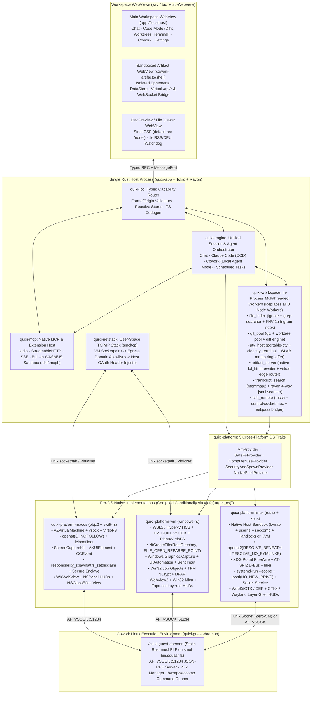
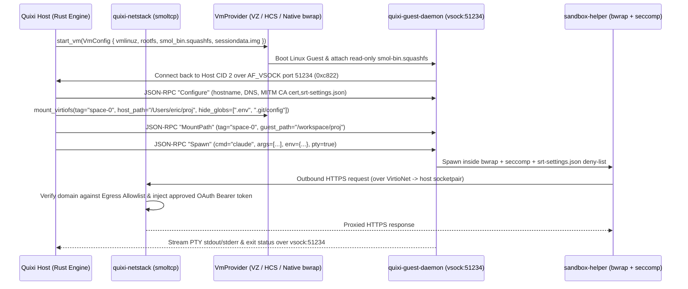
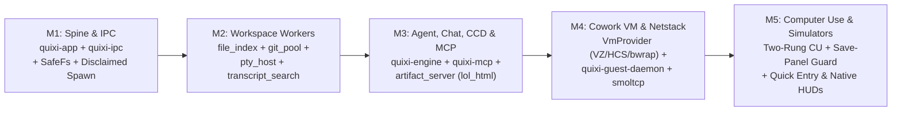

# Quixi Desk — Cross-Platform Architecture & Engineering Blueprint

- **Reference Baseline:** `Claude.app` (`@ant/desktop` `v3.6556.2`, documented in [`ARCHITECTURE.md`](file:///Users/eric/quixi-desk/ARCHITECTURE.md))
- **Target Platforms:** **macOS** (`arm64`, `x86_64`) · **Windows** (`x86_64`, `arm64`) · **Linux** (`x86_64`, `aarch64`)
- **Core Stack:** **Rust** (`tokio`, `rayon`, `wry`/`tao` via Tauri v2 core) + **OS-Native Platform Drivers** (`Swift/objc2` on macOS, `windows-rs` on Windows, `rustix`/`zbus` on Linux) + **TypeScript/React Workspace UI** (`ui/`) + **Static Linux Musl Guest Daemon** (`quixi-guest-daemon`)
- **Node.js / Electron Footprint:** **Zero** (no Node.js runtime, no Chromium bundle, no N-API `.node` addons, no V8 `.jsc` bytecode cache)

---

## 1. Executive Summary & Architectural Philosophy

### 1.1 Lessons from `Claude.app` (`v3.6556.2`)
Our reverse engineering of `Claude.app` ([`ARCHITECTURE.md`](file:///Users/eric/quixi-desk/ARCHITECTURE.md)) exposed a fundamental tension in its design:
1. **Node.js is used as a single-threaded coordinator**, yet nearly every latency-sensitive or OS-integrated feature had to escape Node:
   - **28.3 MB of Swift N-API addons** ([`swift_addon.node`](file:///Users/eric/quixi-desk/binaries/addons/swift_addon.node) + [`computer_use.node`](file:///Users/eric/quixi-desk/binaries/addons/computer_use.node)) for `Virtualization.framework`, `ScreenCaptureKit`, `AXUIElement`, `SwiftUI` overlays, `NSGlassEffectView`, `UserNotifications`, and `CoreSpotlight`.
   - **5.7 MB of Rust N-API bindings** ([`claude-native-binding.node`](file:///Users/eric/quixi-desk/binaries/addons/claude-native-binding.node)) + **3 Rust helper binaries** ([`app-cu-helper`](file:///Users/eric/quixi-desk/binaries/helpers-arm64/app-cu-helper), [`chrome-native-host`](file:///Users/eric/quixi-desk/binaries/helpers-arm64/chrome-native-host), [`claude-ssh-askpass`](file:///Users/eric/quixi-desk/binaries/helpers-arm64/claude-ssh-askpass)) for descriptor-relative Safe-FS (`*Beneath`), Secure Enclave keys, Mach audit tokens, save-panel guards, and input injection.
   - **49 MB of Go binaries** (`sdk-daemon`, `sandbox-helper`, `cli-wrapper`, `claude-shim`, `VZGvisorNetworking`, `claude-ios-sim`, `github-mcp-server`) for VM guest orchestration and user-space networking.
2. **8 separate worker processes** (`fileIndexWorker`, `heavyWorkWorker`, `ptyHostWorker`, `frameLocalWorker`, `directMcpHost`, `nodeHost`, `shellPathWorker`, `transcriptSearchWorker`) plus an in-process V8 profiler thread (`stallSamplerWorker`) had to be spawned via `electron.utilityProcess.fork()` solely to keep CPU/IO work off the single-threaded Node event loop.
3. **10+ auxiliary `BrowserWindow`s** (`QuickWindow`, `AboutWindow`, `buddy`, `localExecConsent`, `CuTeach`, `CuWatchRecordPill`, `CuWatchRecordChooser`, `SableOtterHud`, `designWindow`) had to be created for lightweight UI overlays, requiring cross-process N-API coordinate synchronization with native `NSGlassEffectView` (`sidebarGlass`) and `tearOffHalo`.

### 1.2 The `Quixi Desk` Architecture: Single Rust Spine + 5 Native Platform Traits
Instead of building 3 separate per-OS apps or embedding native code inside Node.js, **Quixi Desk makes Rust the single root executable across macOS, Windows, and Linux**:
- **85–90% Shared Cross-Platform Core (`Rust` + `TypeScript UI`):**
  - The IPC router, agent/session state machines (Chat, Code/CCD, Cowork), MCP host, fuzzy file indexer, git worktree pool, PTY terminal manager, `lol_html` artifact server, `.jsonl` transcript search engine, SSH remote client, and `smoltcp` user-space VM network stack are written **once in pure Rust** running on a single multithreaded `tokio` + `rayon` runtime.
- **10–15% OS-Specific Layer Isolated Behind 5 Rust Traits (`quixi-platform`):**
  1. `VmProvider` (Micro-VM hypervisor & guest transport)
  2. `SafeFsProvider` (Race-free `*Beneath` symlink-proof filesystem containment)
  3. `ComputerUseProvider` (Two-rung background Accessibility + foreground input + Save-Panel guard)
  4. `SecurityAndSpawnProvider` (TCC process disclaiming / Job Objects / cgroups + hardware key signing + OS Keychain)
  5. `NativeShellProvider` (OS WebView host, window vibrancy/Mica/Glass, non-activating HUD/Quick-Entry panels, tray)



---

## 2. Complete Subsystem Mapping: `Claude.app` $\rightarrow$ `Quixi Desk`

Every single binary, worker, preload, and JS chunk in `Claude.app` maps cleanly to a concrete component in `Quixi Desk`:

| `Claude.app` Component (`v3.6556.2`) | Size / Tech in `Claude.app` | `Quixi Desk` Replacement | Architectural Improvement |
|---|---|---|---|
| **Bootstrap & `.jsc` Cache** (`index.pre.js` + `compile-cache/*.jsc`) | 982 KB JS + 9.6 MB V8 bytecode cache | `crates/quixi-app/src/main.rs` | Native AOT-compiled Rust binary; boots in `<20 ms` with zero bytecode cache hacks. |
| **Core Main Bundle** (`index.chunk-jPKPzV-P.js` + 462 chunks) | 6.73 MB + ~18 MB minified JS | `crates/quixi-engine` + `crates/quixi-ipc` | Strongly typed Rust modules; no lazy JS chunk loading stalls. |
| **`@ant/ipc-codegen` (`$eipc_message$`)** (`go` / `Xtt` router, 102 services, 1,400 members) | Runtime JS schema validators | `crates/quixi-ipc` (`#[quixi_service]` proc-macro + `specta` TS codegen) | Compile-time type safety in both Rust & TypeScript; zero-overhead origin/frame guards. |
| **`file-index-worker`** (`fileIndexWorker.js`) | 934 KB Node `utilityProcess` | `quixi_workspace::file_index` (`ignore` + `grep-searcher` + trigram index) | In-process `rayon` worker pool; shares memory directly without IPC serialization. |
| **`frame-local-worker`** (`frameLocalWorker.js` + `html_rewriter_bg.wasm`) | 290 KB Node `utilityProcess` + WASM | `quixi_workspace::artifact_server` (native Rust `lol_html` crate) | Runs `lol_html` natively in the `cowork-artifact://` scheme handler—no WASM or child process. |
| **`heavy-work-worker`** (`heavyWorkWorker.js`, 40 RPC tasks) | 1.15 MB Node `utilityProcess` | `quixi_workspace::{git_pool, archive, hash, a11y}` | Native Rust tasks on `tokio::task::spawn_blocking` / `rayon` (`gix`, `tar`, `zip`, `zstd`, `sha2`). |
| **`mcp-runtime`** (`directMcpHost.js` + `nodeHost.js`) | 623 KB (2 Node `utilityProcess`es) | `crates/quixi-mcp` (`rmcp` + `reqwest` + optional `deno_core`/`quickjs` for JS extensions) | Native Rust stdio/SSE/StreamableHTTP MCP client & router; no `ELECTRON_RUN_AS_NODE` needed. |
| **`pty-host`** (`ptyHostWorker.js` + `pty.node` + `spawn-helper`) | Node `utilityProcess` + C++ addon | `quixi_workspace::pty_host` (`portable-pty` + `alacritty_terminal` + `memmap2`) | Cross-platform BSD PTY / Linux PTY / Windows `ConPTY` with 64 MB mmap scrollback ringbuffer. |
| **`shell-path-worker`** (`shellPathWorker.js`) | Node `utilityProcess` | `quixi_workspace::shell_env` (spawns login shell via `SecurityAndSpawnProvider::spawn_disclaimed`) | Runs once asynchronously at startup (`<shell> -l -i -c 'env -0'`). |
| **`stall-sampler-worker`** (`stallSamplerWorker.js`) | V8 CPU profiler `worker_threads` | **Eliminated** (optional `tracing-chrome` / `pprof` telemetry) | No single-threaded JS event loop to stall. |
| **`transcript-search-worker`** (`transcriptSearchWorker.js`) | 35 KB Node `utilityProcess` | `quixi_workspace::transcript_search` (`memmap2` + `rayon` + `simd-json`) | Parallel memory-mapped `.jsonl` search across `~/.quixi/projects/**/*.jsonl`. |
| **`swift_addon.node`** (18 N-API groups + `VZGvisorNetworking`) | 26.1 MB Swift + Go `cgo` bundle | `crates/quixi-platform-macos` (`objc2` + `swift-rs`) + `crates/quixi-netstack` (`smoltcp`) | Replaces Go `cgo` gVisor with pure Rust `smoltcp` (shared across Mac/Win/Linux); keeps thin Swift only for `VZVirtualMachine` & `SwiftUI` panels. |
| **`computer_use.node` + `app-cu-helper`** | 2.25 MB Swift addon + 979 KB Rust helper | `quixi_platform_{macos,win,linux}::computer_use` | Unified `ComputerUseProvider` trait supporting Rung 1 (background AX) & Rung 2 (foreground input + save-panel guard) on all 3 OSes. |
| **`claude-native-binding.node`** (73 Rust N-API exports) | 5.67 MB Rust NAPI-RS dylib | `quixi_platform::safe_fs`, `quixi_platform::security`, `quixi_platform::input` | Called directly as native Rust functions—zero N-API FFI marshaling. |
| **`Helpers/disclaimer`** | 69 KB C binary | `quixi_platform_macos::spawn::spawn_disclaimed` (plus tiny `quixi-disclaimer` CLI wrapper for child shell scripts) | Calls `responsibility_spawnattrs_setdisclaim` + `posix_spawnattr_setexceptionports_np` directly in Rust `posix_spawn`. |
| **`Helpers/permission-fixer`** | 103 KB Swift `SMJobSubmit` binary | `quixi-permission-fixer` (macOS `SMAppService` / `AuthorizationExecuteWithPrivileges` helper) | Repairs root-owned cache/app permissions if broken by sudo installs. |
| **`Helpers/chrome-native-host`** | 1.1 MB Rust binary | `bins/quixi-chrome-native-host` (Rust) | Identical 4-byte length-prefixed stdin/stdout $\leftrightarrow$ `/tmp/quixi-mcp-browser-bridge-*` UNIX/named-pipe fanout. |
| **`Helpers/claude-ssh-askpass`** | 2.4 MB Rust binary | `bins/quixi-ssh-askpass` (Rust, ~300 KB stripped without Tokio bloat) | Connects to `QUIXI_SSH_ASKPASS_SOCKET` UNIX domain socket / Windows named pipe. |
| **`smol-bin.arm64.img`** (`sdk-daemon`, `sandbox-helper`, `cli-wrapper`, `claude-shim`) | 39 MB exFAT image (4 Go 1.25 binaries) | `crates/quixi-guest-daemon` (single 4 MB multi-call static Rust `musl` binary on a `squashfs` image) | Single ` busybox`-style multi-call binary (`quixi-guest-daemon` symlinked as `/sdk-daemon`, `/sandbox-helper`, `/cli-wrapper`, `/claude-shim`) in a 4 MB read-only `squashfs` image. |

---

## 3. Repository & Cargo Workspace Topology

Everything lives in a single monorepo at `/Users/eric/quixi-desk`:

```text
quixi-desk/
├── Cargo.toml                        # Workspace root (shared dependencies, LTO release profiles)
├── crates/
│   ├── quixi-app/                    # Main desktop executable (wry/tao windowing, custom schemes, lifecycle)
│   ├── quixi-ipc/                    # Capability-scoped RPC router, origin/frame validators, TS codegen
│   ├── quixi-engine/                 # Core domain services:
│   │   ├── src/chat/                 #   Streaming LLM client, conversation trees, tool loop
│   │   ├── src/ccd/                  #   Code Mode (claudeCodeSessionManager, worktree pool, AutoFixEngine)
│   │   ├── src/cowork/               #   Cowork / Local Agent Mode (yukonSilver, VM session bridge, spaces)
│   │   ├── src/computer_use/         #   ComputerUseCoordinator (computer_batch, teach mode, watch-record)
│   │   ├── src/scheduler/            #   Cron & wake-scheduled tasks (CCDScheduledTasks / CoworkScheduledTasks)
│   │   └── src/skills/               #   SKILL.md loader, .skill zip archive manager, marketplace sync
│   ├── quixi-mcp/                    # Native MCP host: stdio, SSE, StreamableHTTP, OAuth 2.1 PKCE, .dxt/.mcpb
│   ├── quixi-workspace/              # Replaces all 8 Node utilityProcesses:
│   │   ├── src/file_index.rs         #   ignore + grep-searcher + FNV-1a trigram index
│   │   ├── src/git_pool.rs           #   gix + git worktree pool + diff/status parser
│   │   ├── src/pty_host.rs           #   portable-pty + alacritty_terminal + 64MB disk-backed ringbuffer
│   │   ├── src/artifact_server.rs    #   cowork-artifact:// handler + lol_html rewriter + virtual /api/*
│   │   ├── src/transcript_search.rs  #   memmap2 + rayon 4-way concurrent .jsonl search
│   │   └── src/ssh_remote.rs         #   russh + OpenSSH control socket mux + remote agent bootstrap
│   ├── quixi-netstack/               # User-space TCP/IP stack (smoltcp) for VM egress filtering & OAuth injection
│   ├── quixi-proto/                  # Shared wire definitions (vsock:51234 RPC, IPC schemas, .jsonl formats)
│   ├── quixi-platform/               # OS abstraction traits: VmProvider, SafeFs, ComputerUse, Security, NativeShell
│   ├── quixi-platform-macos/         # macOS implementation (objc2, swift-rs -> SwiftBridge/)
│   ├── quixi-platform-win/           # Windows implementation (windows-rs: HCS, NtCreateFile, UIAutomation, ConPTY)
│   ├── quixi-platform-linux/         # Linux implementation (rustix, zbus: openat2, bwrap/seccomp/landlock, PipeWire)
│   └── quixi-guest-daemon/           # Static musl Linux binary (coworkd + sandbox-helper + cli-wrapper + claude-shim)
├── bins/
│   ├── quixi-disclaimer/             # Tiny C/Rust responsibility_spawnattrs_setdisclaim wrapper for scripts
│   ├── quixi-chrome-native-host/     # Chrome Native Messaging <-> Unix socket / Named Pipe bridge
│   └── quixi-ssh-askpass/            # SSH_ASKPASS prompt helper
└── ui/                               # TypeScript + React + Vite frontend (served via app://localhost)
    ├── src/generated/ipc.ts          # Auto-generated typed RPC client from crates/quixi-ipc
    ├── src/surfaces/main/            # Chat, Code Mode (CCD), Cowork, Settings, Diff/Terminal views
    ├── src/surfaces/artifact-shell/  # cowork-artifact://shell runtime & fetch/WebSocket interceptor
    └── src/surfaces/file-viewer/     # Zero-privilege sandboxed PPTX/DOCX/PDF/Markdown viewer
```

---

## 4. Windowing, Multi-WebView & Native Overlay Architecture

### 4.1 Fixing `Claude.app`'s Two-Layer Window & 10-Popout Problem
In `Claude.app`, the main window uses a outer `BrowserWindow` (`mainWindow.js`) hosting a child `WebContentsView` (`mainView.js`), plus 10+ separate `BrowserWindow`s for overlays (`QuickWindow`, `CuTeach`, `CuWatchRecordPill`, `CuWatchRecordChooser`, `SableOtterHud`, `localExecConsent`, `buddy`, `aboutWindow`).

In `Quixi Desk`, we split UI surfaces into **two categories**:

1. **Native OS Chrome & Instant Overlays (`NativeShellProvider` — Zero WebView Overhead):**
   - **Window Vibrancy / Material:** Native `NSGlassEffectView` / `NSVisualEffectView` (macOS), Win32 Mica / Acrylic (`DwmSetWindowAttribute` on Windows), and GTK4 / Wayland blur (Linux).
   - **Quick Entry Launcher (`Cmd+Space` / `Alt+Space`):** Native `NSPanel` (`.nonactivatingPanel`, macOS), layered topmost Win32 window (Windows), or Wayland `wlr-layer-shell` overlay (Linux) that appears in `<2 ms` without booting a browser process.
   - **Computer Use HUDs (`CuTeach`, `CuWatchRecordPill`, `PhantomCursor`, `TearOffHalo`):** Rendered as click-through native OS overlay layers (`ignoresMouseEvents = true`) directly synchronized with the window server.
   - **Local Execution & Tool Consent Modal (`localExecConsent`):** Native OS sheet/dialog (`NSAlert` / `NSPanel` on macOS, TaskDialog/WinUI modal on Windows, GTK4 dialog on Linux) so a compromised renderer can never spoof a user click on a security consent prompt.

2. **Isolated Multi-WebView Content Surfaces (`wry` / `tao`):**
   - **Primary Workspace WebView (`WebViewRole::MainWorkspace`):**
     - Loads `app://localhost/index.html` (100% local bundle—no dependency on remote `https://claude.ai` availability, while still supporting optional remote web workspaces in an isolated child view if desired).
     - Renders the unified **Chat**, **Cowork**, and **Code (CCD)** tabs, integrated `xterm.js` terminal, diff viewer, and settings.
   - **Typed Artifact Child WebView (`WebViewRole::ArtifactShell`):**
     - Uses an ephemeral/isolated `WebContext` (equivalent to `persist:cowork-artifact...`).
     - Loads `cowork-artifact://shell/<artifact-id>` via a custom URI scheme handler backed by `quixi_workspace::artifact_server`.
   - **Untrusted File Viewer Child WebView (`WebViewRole::SandboxedFileViewer`):**
     - Used for rendering untrusted DOCX, PPTX, PDF, CSV, and HTML previews.
     - **Zero IPC bridge injected** (no `window.quixi` or `window.ipc`).
     - Enforces `Claude.app`'s exact TrustedTypes CSP header:
       ```http
       Content-Security-Policy: default-src 'none'; script-src 'self'; style-src 'self'; img-src data: blob:; connect-src 'self'; require-trusted-types-for 'script'; sandbox allow-scripts allow-same-origin
       ```
     - Monitored by a 1-second Rust watchdog task (`sysinfo` / `proc_pid_rusage` / `GetProcessMemoryInfo`) that kills and respawns the WebView process if RSS exceeds `512 MB` or CPU pins at 100% for $>5\text{ s}$.

---

## 5. Typed Capability-Scoped IPC Engine (`quixi-ipc`)

### 5.1 Preserving `@ant/ipc-codegen`'s Security Model Without JS Boilerplate
In `Claude.app` ([`reference/ipc-sender-validators.txt`](file:///Users/eric/quixi-desk/reference/ipc-sender-validators.txt)), `go(namespace, service, senderValidator, schema)` registers handlers per `WebContents` and enforces:
1. **Top-Frame Enforcement (`DSe`):** `event.senderFrame?.parent === null` (blocks any `<iframe>` or subframe from invoking IPC).
2. **Strict Origin Scoping (`Ay`, `h_t`, `ola`, `zaa`):**
   - `h_t`: Only `app://localhost` can invoke `Custom3pHelperRun`, `Custom3pApiKeySignIn`, or `ClaudeAiImport`.
   - `ola` / `zaa`: Only `cowork-artifact://shell` can invoke `ArtifactShellTransport` or `CoworkArtifactBridge`.
3. **Three Member Primitives:** Async `methods` (`invoke`), reactive `stores` (`getState`, `getStateSync`, `$store$_update`), and server-to-client `events` (`dispatch<Event>`).

### 5.2 How `quixi-ipc` Implements This in Rust
We define services using a declarative Rust attribute macro `#[quixi_service]` that compiles down to a capability-checked dispatcher and automatically emits `ui/src/generated/ipc.ts` via `specta`:

```rust
#[derive(Debug, Clone, Copy, PartialEq, Eq)]
pub enum CallerOriginPolicy {
    /// Strictly top-level frame at `app://localhost` (Settings, Credentials, Local Sessions)
    AppLocalhostOnly,
    /// Top-level frame at `app://localhost` or authorized workspace origin
    WorkspaceMain,
    /// Strictly `cowork-artifact://shell`
    ArtifactShellOnly,
    /// Strictly `cowork-artifact://<id>`
    CoworkArtifactOnly,
    /// Internal native/overlay WebViews only
    InternalUiOnly,
}

pub struct IpcCallContext {
    pub webview_id: WebViewId,
    pub is_main_frame: bool,
    pub origin: url::Origin,
    pub capabilities: BitFlags<WebViewCapability>,
}

impl IpcCallContext {
    pub fn verify(&self, policy: CallerOriginPolicy) -> Result<(), IpcSecurityError> {
        if !self.is_main_frame {
            return Err(IpcSecurityError::SubframeRejected);
        }
        match policy {
            CallerOriginPolicy::AppLocalhostOnly => {
                ensure!(self.origin.ascii_serialization() == "app://localhost", IpcSecurityError::InvalidOrigin);
            }
            CallerOriginPolicy::ArtifactShellOnly => {
                ensure!(self.origin.ascii_serialization() == "cowork-artifact://shell", IpcSecurityError::InvalidOrigin);
            }
            // ...
        }
        Ok(())
    }
}
```

### 5.3 Rationalizing `Claude.app`'s 102 Services into 16 Focused Rust Services
`Claude.app` accumulated 102 services across 19 namespaces ([`reference/ipc-catalog-1400-members.txt`](file:///Users/eric/quixi-desk/reference/ipc-catalog-1400-members.txt)) due to organic feature growth (`GrandPrix`, `ViolinFret`, `Gorse`, `CopperHeron`, `SableOtter`, `YukonSilver`). `Quixi Desk` consolidates all 1,400 capabilities into **16 clean domain services**:

| `Quixi Desk` Service (`quixi-ipc`) | Origin Policy | Consolidates `Claude.app` Services |
|---|---|---|
| `quixi.settings.AppConfig` | `AppLocalhostOnly` | `AppConfig`, `AppFeatures`, `AppPreferences`, `ManagedConfig`, `Startup`, `DesktopInfo`, `GlobalShortcut` |
| `quixi.settings.ProvidersAndAuth` | `AppLocalhostOnly` | `Auth`, `Account`, `Custom3pSetup`, `Custom3pApiKeySignIn`, `Custom3pHelperRun`, `Custom3pUsage`, `DeviceRegistry` |
| `quixi.workspace.Sessions` | `WorkspaceMain` | `LocalSessions`, `LocalAgentModeSessions`, `ClaudeCode`, `LocalSessionEnvironment`, `LocalSessionPresets`, `HistoryImport`, `CliSessionImport` |
| `quixi.workspace.SpacesAndMemory` | `WorkspaceMain` | `CoworkSpaces`, `CoworkMemory`, `CoworkStorage`, `CoworkUserFiles`, `DocumentFunnel` |
| `quixi.workspace.FileSystem` | `WorkspaceMain` | `FileSystem`, `FilePickers`, `Resources`, `DeviceStorage` |
| `quixi.workspace.GitAndWorktrees` | `WorkspaceMain` | `GitState`, `ForgeState`, `SourceBranchPrefetch` |
| `quixi.workspace.Terminal` | `WorkspaceMain` | `PtyHostManager` IPC + terminal screen streams |
| `quixi.workspace.LaunchPreview` | `WorkspaceMain` | `Launch` (117 members: dev server auto-detection, live browser preview, inspect, console logs, screenshots) |
| `quixi.workspace.Artifacts` | `WorkspaceMain` | `CoworkArtifacts`, `CoworkFilePreview`, `DesignPdf`, `EngineSurface` |
| `quixi.artifact.Bridge` | `CoworkArtifactOnly` | `CoworkArtifactBridge` (`askClaude`, `callMcpTool`, `runScheduledTask`), `ArtifactShellTransport` |
| `quixi.mcp.Registry` | `WorkspaceMain` | `MCP`, `Extensions` (`.dxt`/`.mcpb`), `LocalPlugins`, `CustomPlugins`, `PluginBridgeMcp`, `ChromeExtension`, `OfficeAddinFiles` |
| `quixi.skills.SkillsManager` | `WorkspaceMain` | `Skills`, local/bundled `SKILL.md` discovery & `.skill` zip installer |
| `quixi.vm.SandboxManager` | `WorkspaceMain` | `ClaudeVM` (`startVM`, `restartVM`, `checkVirtualMachinePlatform`, `download`, status streams) |
| `quixi.cu.Coordinator` | `WorkspaceMain` | `ComputerUseTcc`, `ComputerUseLivePreview`, `CuTeach`, `CuWatchRecordPill`, `CuWatchRecordChooser` |
| `quixi.simulator.Simulator` | `WorkspaceMain` | `Simulator` (71 members: iOS `simctl` + `WKWebView` sim + Android `adb`/emulator + foldable hinge state) |
| `quixi.schedule.TasksAndRemote` | `WorkspaceMain` | `CCDScheduledTasks`, `CoworkScheduledTasks`, `WakeScheduler`, `RemoteControlServing` |

---

## 6. Collapsing the 8 Node Workers into `quixi-workspace`

In `Claude.app`, 8 separate worker processes had to be forked and managed over `MessagePort`s. Here is how `crates/quixi-workspace` executes all of them inside our single Rust binary:

### 6.1 `file_index` (Replaces `fileIndexWorker.js`)
- **File Discovery:** Uses the `ignore` crate's `WalkParallel` (honoring `.gitignore`, `.claudeignore`, `.rgignore`) across a `rayon` threadpool.
- **Fuzzy Path Index:** Builds a compact in-memory arena of file paths indexed by **FNV-1a character trigrams** + nucleo/frizbee SIMD fuzzy matcher (`<1 ms` query time across 500,000 files).
- **Content Search:** Uses `grep-searcher` + `grep-regex` directly in memory on `rayon` threads (no need to spawn external `git grep` subprocesses), streaming matches over a Rust `tokio::sync::mpsc` channel to the requesting WebView.
- **Staging & Snapshot:** Implements `stage-git-listing`, `commit-staged-git`, and `discard-staged-git` atomically via `ArcSwap<FileIndexSnapshot>`.

### 6.2 `artifact_server` (Replaces `frameLocalWorker.js` + `html_rewriter_bg.wasm`)
- In `Claude.app`, `artifactShell.js` intercepts `window.fetch` and `window.WebSocket` for `/api/*` and `/edge-api/*`, forwarding them over a `MessagePort` to `frameLocalWorker.js`, which runs Cloudflare's `lol-html` compiled to WebAssembly (`html_rewriter_bg.wasm`).
- In `Quixi Desk`:
  - `wry::WebViewBuilder::with_custom_protocol("cowork-artifact", ...)` intercepts every request to `cowork-artifact://shell/<id>` and `cowork-artifact://<id>/api/*` **directly at the network scheme layer in Rust**.
  - HTML/script injection and CSP sanitation run through the **native Rust `lol_html` crate** in a streaming zero-allocation pipeline (`10x` faster than WASM-in-Node, without needing `window.fetch` monkey-patching).

### 6.3 `git_pool` (Replaces `heavyWorkWorker.js` Git & Worktree Tasks)
- Implements `Claude.app`'s **Git Worktree Pool (`createWorktreePool`)** used by Code Mode (CCD) so multiple parallel agent branches can run simultaneously in isolated worktrees without dirtying the user's primary working tree:
  - Uses `gix` (`gitoxide`) for fast in-process `gitStatus`, `gitDiff`, `gitCommits`, branch enumeration, and SHA-256 blob hashing.
  - Uses `SafeFsProvider::clone_at` (`fclonefileat` APFS copy-on-write clones on macOS, `FICLONE` on Linux Btrfs/XFS, `FSCTL_DUPLICATE_EXTENTS_TO_FILE` on Windows ReFS) for instant, zero-disk-space worktree file copying (`copyWorktreeFiles`).

### 6.4 `pty_host` (Replaces `ptyHostWorker.js` + `pty.node` + `spawn-helper`)
- Uses `portable-pty` to spawn pseudo-terminals across macOS/Linux (`forkpty`) and Windows (`ConPTY`).
- Embeds shell integration scripts (`quixi-shell.{zsh,bash,fish,ps1}`) that emit **OSC 1337 / OSC 633** markers for prompt start, command start, command output, and exit code + current working directory tracking.
- Runs `alacritty_terminal` in-memory to maintain live headless terminal screen state (`terminalScreen` RPC in `Claude.app`'s `heavyWorkWorker.js`, which previously required running `@xterm/headless` in Node!).
- Persists scrollback in a **rotating 64 MB disk-backed ringbuffer** (16 × 4 MB segment files) with secret redaction before disk flush.

### 6.5 `transcript_search` (Replaces `transcriptSearchWorker.js`)
- Session transcripts are stored as append-only `.jsonl` files under `~/.quixi/projects/<project-slug>/<session-id>.jsonl` (compatible with `~/.claude/projects/**/*.jsonl`).
- Uses `SafeFsProvider::open_beneath` (`O_NOFOLLOW`) + `memmap2::Mmap` + `memchr::memmem` SIMD substring pre-filtering across `rayon` threads to search thousands of session transcripts in `<5 ms`.

---

## 7. The 5 Cross-Platform OS Traits (`quixi-platform`)

All OS-specific syscalls and frameworks sit behind 5 traits in `crates/quixi-platform/src/lib.rs`:

### 7.1 Trait 1: `SafeFsProvider` (Race-Free `*Beneath` Containment — `CC-2885`)
Replaces `claude-native-binding.node`'s `*Beneath` family (`openRootDir`, `openBeneath`, `statBeneath`, `lstatBeneath`, `mkdirBeneath`, `rmdirBeneath`, `renameBeneath`, `unlinkBeneath`, `readdirBeneath`, `cloneAt`). Prevents any agent tool, archive extractor, or skill installer from escaping an approved workspace directory via symlink races (TOCTOU):

```rust
pub trait SafeFsProvider: Send + Sync {
    type RootDirHandle: Send + Sync;

    fn open_root_dir(&self, canonical_path: &Path) -> io::Result<Self::RootDirHandle>;
    fn open_beneath(&self, root: &Self::RootDirHandle, rel: &Path, flags: OpenFlags) -> io::Result<std::fs::File>;
    fn stat_beneath(&self, root: &Self::RootDirHandle, rel: &Path, follow_last: bool) -> io::Result<FileStat>;
    fn mkdir_beneath(&self, root: &Self::RootDirHandle, rel: &Path, mode: u32) -> io::Result<()>;
    fn unlink_beneath(&self, root: &Self::RootDirHandle, rel: &Path) -> io::Result<()>;
    fn rename_beneath(&self, root: &Self::RootDirHandle, from: &Path, to: &Path) -> io::Result<()>;
    fn readdir_beneath(&self, root: &Self::RootDirHandle, rel: &Path) -> io::Result<Vec<DirEntry>>;
    fn clone_at(&self, src_root: &Self::RootDirHandle, src: &Path, dst_root: &Self::RootDirHandle, dst: &Path) -> io::Result<()>;
}
```

- **Linux (`quixi-platform-linux`):** Direct `rustix::fs::openat2(root_fd, rel, OpenHow { flags, mode, resolve: ResolveFlags::BENEATH | ResolveFlags::NO_SYMLINKS | ResolveFlags::NO_MAGICLINKS })`. Single kernel syscall, zero race window.
- **macOS (`quixi-platform-macos`):** Component-by-component descriptor walk using `openat(cur_fd, component, O_RDONLY | O_DIRECTORY | O_NOFOLLOW | O_SYMLINK)`, verifying `fcntl(fd, F_GETPATH)` prefix on fallback, plus `fclonefileat()` for CoW clones and `SF_DATALESS` check (`materializeDatalessFile`) to avoid hanging on un-downloaded iCloud Drive files.
- **Windows (`quixi-platform-win`):** `NtCreateFile` passing `RootDirectory = root_handle` in `OBJECT_ATTRIBUTES` with `FILE_OPEN_REPARSE_POINT` inspection to reject `IO_REPARSE_TAG_SYMLINK` and `IO_REPARSE_TAG_MOUNT_POINT` junctions pointing outside the root volume/tree.

---

### 7.2 Trait 2: `SecurityAndSpawnProvider` (Process Disclaiming, Hardware Keys & Keychain)
Replaces `Helpers/disclaimer` and `claude-native-binding.node`'s `hardwareKey*` / `attestedMachRequest`:

```rust
pub trait SecurityAndSpawnProvider: Send + Sync {
    /// Spawns a child process (git, shell, MCP server) disclaimed from parent TCC/Job attribution
    /// with a parent-death watchdog (kqueue EVFILT_PROC / JobObject / PR_SET_PDEATHSIG).
    fn spawn_disclaimed(&self, spec: &DisclaimedSpawnSpec) -> io::Result<DisclaimedChild>;

    /// Hardware-bound non-exportable P-256 signing key for device attestation & session binding.
    fn hardware_key_get_or_create(&self, tag: &str) -> Result<PublicKeyBytes, SecurityError>;
    fn hardware_key_sign(&self, tag: &str, preimage: &[u8]) -> Result<SignatureBytes, SecurityError>;
}
```

- **macOS (`quixi-platform-macos`):**
  - Calls Apple's private `responsibility_spawnattrs_setdisclaim(&attr, 1)` (resolved via `dlsym(RTLD_DEFAULT, "responsibility_spawnattrs_setdisclaim")`, exact logic from [`Helpers/disclaimer` `_main` at `0x100000608`](file:///Users/eric/quixi-desk/binaries/helpers-arm64/disclaimer)) so child CLI tools prompt for their own TCC permissions rather than inheriting or polluting `Quixi Desk.app`.
  - Resets Mach exception ports via `posix_spawnattr_setexceptionports_np(&attr, EXC_MASK_ALL, MACH_PORT_NULL, EXCEPTION_DEFAULT, THREAD_STATE_NONE)` so crash reporters do not swallow child process signals.
  - Hardware keys use `Security.framework` `SecKeyCreateRandomKey` with `kSecAttrTokenIDSecureEnclave` and access group `com.quixi.desktop.hwkey`.
- **Windows (`quixi-platform-win`):**
  - Spawns child processes inside a Win32 Job Object configured with `JOB_OBJECT_LIMIT_KILL_ON_JOB_CLOSE | JOB_OBJECT_LIMIT_BREAKAWAY_OK`.
  - Hardware keys use Windows Next Generation Cryptography (`NCryptOpenStorageProvider(MS_PLATFORM_CRYPTO_PROVIDER)` TPM 2.0 key storage).
- **Linux (`quixi-platform-linux`):**
  - Configures `prctl(PR_SET_PDEATHSIG, SIGTERM)` and `prctl(PR_SET_NO_NEW_PRIVS, 1)` in `pre_exec`, optionally wrapping long-running MCP servers in a transient systemd scope (`systemd-run --user --scope`).
  - Hardware keys use `/dev/tpmrm0` (`tss-esapi`) with fallback to `org.freedesktop.secrets` (Secret Service D-Bus API via `zbus`).

---

### 7.3 Trait 3: `ComputerUseProvider` (Two-Rung GUI Automation & Save-Panel Guard)
Replaces `computer_use.node`, `app-cu-helper`, and `claude-native-binding.node`'s `cuSavePanelProbe*`:

```rust
pub trait ComputerUseProvider: Send + Sync {
    // --- Rung 1: Background App-Scoped Control (Does NOT hijack physical mouse cursor) ---
    fn capture_window(&self, window_id: WindowId) -> Result<RgbaFrame, CuError>;
    fn inspect_ax_tree(&self, pid: u32, max_depth: usize) -> Result<AxNode, CuError>;
    fn perform_ax_action(&self, pid: u32, element_path: &AxPath, action: AxAction) -> Result<(), CuError>;
    fn set_phantom_cursor(&self, pos: ScreenPoint, state: PhantomCursorState) -> Result<(), CuError>;
    fn ms_since_last_human_mouse_down(&self) -> u64;

    // --- Rung 2: Foreground Desktop Input Injection & Security Guards ---
    fn capture_display(&self, display_id: DisplayId, exclude_own_windows: bool) -> Result<RgbaFrame, CuError>;
    fn inject_input(&self, batch: &[CuInputAction]) -> Result<(), CuError>;
    fn probe_save_panel_at_point(&self, pt: ScreenPoint) -> Result<Option<SavePanelInfo>, CuError>;
}
```

- **Why the Two-Rung Model + Save-Panel Guard from `Claude.app` Is Critical:**
  - **Rung 1 (App-Scoped Background):** When automating a target app, `Quixi Desk` first attempts to capture just that window (`ScreenCaptureKit` `SCContentFilter(desktopIndependentWindow:)` on macOS, `Windows.Graphics.Capture` `CreateForWindow` on Windows) and dispatch clicks/text via the Accessibility API (`AXUIElementPerformAction` on macOS, `IUIAutomationInvokePattern` on Windows, `AT-SPI2` on Linux) while rendering a **Phantom Cursor** over the target window. Meanwhile, `ms_since_last_human_mouse_down` monitors physical HID events so if the human user touches their mouse, automation yields immediately (`collisionWatch`).
  - **Rung 2 (Save-Panel Guard `cuSavePanelProbe`):** When falling back to raw `CGEvent` / `SendInput` / `libei` mouse/keyboard injection, a clever prompt injection inside a document could instruct the agent to press `Cmd+S` $\rightarrow$ `Cmd+Shift+G` and save a malicious file into `~/.ssh/` or `~/Library/LaunchAgents/`. Just like `Claude.app`'s `cuSavePanelProbeAtPoint`, before every injected click or `Return` keystroke, `Quixi Desk` queries the accessibility role of the focused window/sheet; if it is an OS Open/Save panel (`NSOpenPanel`/`NSSavePanel`, Win32 `#32770` `IFileDialog`, or `GtkFileChooserNative`), it reads the panel's current target directory path and **blocks the action unless the directory is inside an approved workspace folder**.

---

### 7.4 Trait 4: `VmProvider` & Cowork Micro-VM Architecture

Replaces `CoworkVMManager` in `swift_addon.node` and `smol-bin.{arm64,x64}.img`:



#### How `VmProvider` Operates on Each OS:
1. **macOS (`quixi-platform-macos` via `Virtualization.framework`):**
   - Uses `VZLinuxBootLoader` (`vmlinuz` + `initrd`), attaching 3 `VZVirtioBlockDeviceConfiguration` drives:
     1. `rootfs.img` (Ubuntu/Alpine minimal rootfs, updated via zstd delta patching `apply_vm_image_delta`).
     2. `sessiondata.img` (10 GB sparse ext4 volume mounted at `/sessions`).
     3. `smol-bin.squashfs` (read-only image containing our static `quixi-guest-daemon` binary).
   - Attaches `VZVirtioSocketDeviceConfiguration` (`vsock` port `51234`), `VZVirtioFileSystemDeviceConfiguration` (VirtioFS for hot-mounting host folders), and `VZFileHandleNetworkDeviceAttachment` connected to a Unix `socketpair(AF_UNIX, SOCK_DGRAM)` (MTU 65535) wired directly into `crates/quixi-netstack` (`smoltcp`).
2. **Windows (`quixi-platform-win` via Windows Hypervisor Platform / HCS):**
   - Boots the **exact same `vmlinuz`, `rootfs.img`, and `smol-bin.squashfs`** using Windows Host Compute Service (`vmcompute.dll` / `HcsCreateComputeSystem`) or WSL2 custom kernel integration.
   - Connects to `quixi-guest-daemon` over Hyper-V `AF_VSOCK` (`HV_GUID_VSOCK` port `51234`) and shares host directories via Plan9 / VirtioFS.
3. **Linux (`quixi-platform-linux` — Zero-VM Native Sandbox Mode + Optional KVM Mode):**
   - Because the host kernel **is already Linux**, `Quixi Desk` on Linux does not need to pay the RAM or boot cost of a nested VM by default!
   - **Default Fast Mode (Zero-VM):** Runs `quixi-guest-daemon` directly on the Linux host inside a rootless user/mount/PID/network namespace (`unshare(CLONE_NEWUSER | CLONE_NEWNS | CLONE_NEWPID | CLONE_NEWNET)`), connecting its virtual network interface (`pasta` / `slirp4netns` or `socketpair`) to `quixi-netstack` and communicating over a local UNIX socket speaking the identical `vsock:51234` JSON-RPC protocol.
   - **Strict Isolation Mode (KVM):** Boots `vmlinuz` + `rootfs.img` + `smol-bin.squashfs` via `/dev/kvm` (`cloud-hypervisor` or built-in `kvm-ioctls` micro-VM) over `AF_VSOCK` port `51234`.

---

## 8. Inside `quixi-guest-daemon` & `quixi-netstack`

### 8.1 Replacing the 4 Go Binaries in `smol-bin.img` with One Multi-Call Static Rust Binary
In `Claude.app`, `smol-bin.arm64.img` is a 39 MB exFAT image containing 4 separate static Go binaries (`sdk-daemon`, `sandbox-helper`, `cli-wrapper`, `claude-shim`) plus `srt-settings.json`.
In `Quixi Desk`, `crates/quixi-guest-daemon` compiles to a **single ~3.5 MB static `musl` Rust binary** (`aarch64-unknown-linux-musl` and `x86_64-unknown-linux-musl`) that dispatches on `argv[0]` (just like `busybox`):

1. **`/sdk-daemon` (`coworkd` equivalent):**
   - Listens/connects on `AF_VSOCK` port `51234` (`0xc822`) using 4-byte big-endian length-prefixed JSON-RPC frames.
   - Implements all `CoworkVMManager` RPC methods:
     - `Configure`: Sets guest clock, hostname, DNS, environment variables, and loads `srt-settings.json`.
     - `MountPath`: Mounts a VirtioFS tag into `/workspace/<name>` and applies bind-mount masks (`hideJson`) over sensitive paths (e.g. `.env`, `.git/hooks`) by bind-mounting `/dev/null` or an empty `tmpfs` over them.
     - `Spawn` / `Kill` / `WriteStdin` / `ResizePty`: Spawns guest commands inside pseudo-terminals (`rustix::pty`) and streams stdout/stderr chunks back over vsock.
     - `ReadFile` / `WriteFile`: Direct streaming file transfer between host and guest.
     - `AddApprovedOauthToken`: Registers scoped credential handles for the guest proxy.
2. **`/sandbox-helper`:**
   - Wraps every individual command spawned by the agent inside an inner **Bubblewrap (`bwrap`) / Linux namespace + Landlock + `seccomp-bpf` sandbox**, enforcing the exact filesystem deny-list from `Claude.app`'s `srt-settings.json`:
     - **Writable:** `/workspace/*`, `/sessions/*`, `/tmp`, `/var/tmp`.
     - **Read-Only / Denied Writes:** `/etc/{passwd,shadow,sudoers*,ssh,pam.d,ld.so.*,crontab,cron.*,init.d,rc.local,systemd}`, `/usr/lib/systemd`, `/boot`, `/proc/sys`, `/sys`.
3. **`/cli-wrapper` & `/claude-shim`:**
   - Forwards guest CLI invocations and `onGuestRequest` callbacks (such as asking the host to open a browser URL, request a tool permission, or invoke a host-side MCP tool) back across `vsock:51234` to the host `quixi-engine`.

### 8.2 `quixi-netstack`: Pure-Rust User-Space Networking (Replaces Go `VZGvisorNetworking`)
In `Claude.app`, `swift_addon.node` statically links a Go `cgo` archive (`VZGvisorNetworking`) to run a user-space TCP/IP stack on the host end of the VM's network `socketpair`.
In `Quixi Desk`, `crates/quixi-netstack` uses the pure-Rust **`smoltcp`** crate:
- Reads raw Ethernet frames from the VM `socketpair` (MTU 65535), terminates TCP/UDP in user space on the host (`tokio`), and enforces:
  1. **DNS & Domain Egress Allowlisting:** Blocks arbitrary data exfiltration to unknown domains unless permitted by workspace policy.
  2. **Host-Side Credential Injection:** Guest processes never see raw OAuth refresh tokens or API keys in their environment variables. Instead, guest processes send requests with a placeholder token (`Bearer quixi-proxy-token-<id>`), and `quixi-netstack`'s HTTP proxy layer swaps in the real credential on the host side only when connecting to the authorized API endpoint.

---

## 9. Native MCP Host & Extension Runtime (`quixi-mcp`)

### 9.1 Running MCP Servers Without Bundling Node.js
In `Claude.app`, disabling the `RunAsNode` Electron fuse forced Anthropic to build `mcp-runtime/nodeHost.js` and `directMcpHost.js` to run local `.js` MCP servers and `.dxt`/`.mcpb` extensions.

`crates/quixi-mcp` handles all 4 MCP server classes natively in Rust:
1. **Remote MCP (`StreamableHTTP` & `SSE`):**
   - Handled directly in Rust via `reqwest` + `eventsource-stream` + OAuth 2.1 PKCE flow (`authorizeAndProbeMcpServer`), storing tokens in the OS Keychain.
2. **Native Binary MCP (`stdio`):**
   - Spawns static or system binaries (such as bundled `github-mcp-server`, Rust/Go/Python `uvx` servers, or user-configured `npx` commands if Node is installed on the user's system) using `SecurityAndSpawnProvider::spawn_disclaimed` + `shell_env` user `PATH`.
3. **In-Process Built-in MCP Servers:**
   - Built-in capabilities (`Filesystem` via `SafeFsProvider`, `Fetch`, `Memory`, `ComputerUse`, `Simulator`, `DevPreview` `preview_*` tools, and `ImagineCanvas`) run **in-process as zero-overhead Rust trait implementations** of `McpServerHandler`—no child process or stdio pipe needed.
4. **Portable `.dxt` / `.mcpb` & `.skill` Extensions:**
   - Supports WebAssembly Component Model (`.wasm` via `wasmtime` with WASI capability sandboxing) as the first-class portable extension format, and for legacy `.js` `.dxt` bundles, either delegates to the user's system `node`/`bun`/`deno` inside a `SafeFs` + `disclaimer` sandbox or embeds a lightweight `deno_core` / `rquickjs` worker crate.

---

## 10. Phased Implementation Roadmap in `~/quixi-desk`

We can build and verify `Quixi Desk` incrementally in 5 milestones:



### Milestone 1: Core Spine, Typed IPC & Platform Security Primitives
- Initialize the Cargo workspace (`crates/quixi-{app,ipc,platform,platform-macos,platform-win,platform-linux}`) and `ui/` frontend.
- Implement `quixi-ipc` with `CallerOriginPolicy` (`AppLocalhostOnly`, `WorkspaceMain`, `ArtifactShellOnly`), top-frame verification, and automatic TypeScript client generation (`ui/src/generated/ipc.ts`).
- Implement `SafeFsProvider` (`openat(O_NOFOLLOW)` on macOS, `openat2(RESOLVE_BENEATH)` on Linux, `NtCreateFile` on Windows) and `SecurityAndSpawnProvider` (`responsibility_spawnattrs_setdisclaim` on macOS, Job Objects on Windows, `prctl` on Linux).

### Milestone 2: In-Process Multithreaded Workspace Engine (`quixi-workspace`)
- Build `file_index` (`ignore` + `grep-searcher` + FNV-1a trigram index), `git_pool` (`gix` + CoW worktree cloning), `pty_host` (`portable-pty` + `alacritty_terminal` + 64 MB mmap scrollback + shell hooks), and `transcript_search` (`memmap2` + `rayon`).

### Milestone 3: Agent Engine, Code Mode (CCD), Native MCP & Artifact Server
- Build `quixi-engine` (streaming LLM client, `.jsonl` transcript persistence, session branching, Code Mode worktree orchestration) and `quixi-mcp` (stdio, StreamableHTTP, SSE, in-process tools).
- Register the `cowork-artifact://` custom URI scheme backed by native `lol_html` and the sandboxed `fileViewer` WebView with its 1-second RSS/CPU watchdog.

### Milestone 4: Cowork Micro-VM (`VmProvider`), `quixi-guest-daemon` & `quixi-netstack`
- Cross-compile `quixi-guest-daemon` (`sdk-daemon`, `sandbox-helper`, `cli-wrapper`, `claude-shim`) into a static Linux `musl` binary packaged into `smol-bin.squashfs`.
- Wire `VmProvider` to `Virtualization.framework` on macOS, HCS/WSL2 on Windows, and native `bwrap`+`seccomp`+`landlock` on Linux, connected to `quixi-netstack` (`smoltcp`) and `AF_VSOCK` port `51234`.

### Milestone 5: Two-Rung Computer Use, Native Overlays & Simulator Control
- Implement `ComputerUseProvider` (Rung 1 background AX + Phantom Cursor + human mouse collision detector; Rung 2 foreground input + Save-Panel path guard).
- Add native non-activating overlays (`QuickEntry`, `CuTeach`, `CuWatchRecordPill`) and `Simulator` integration.
