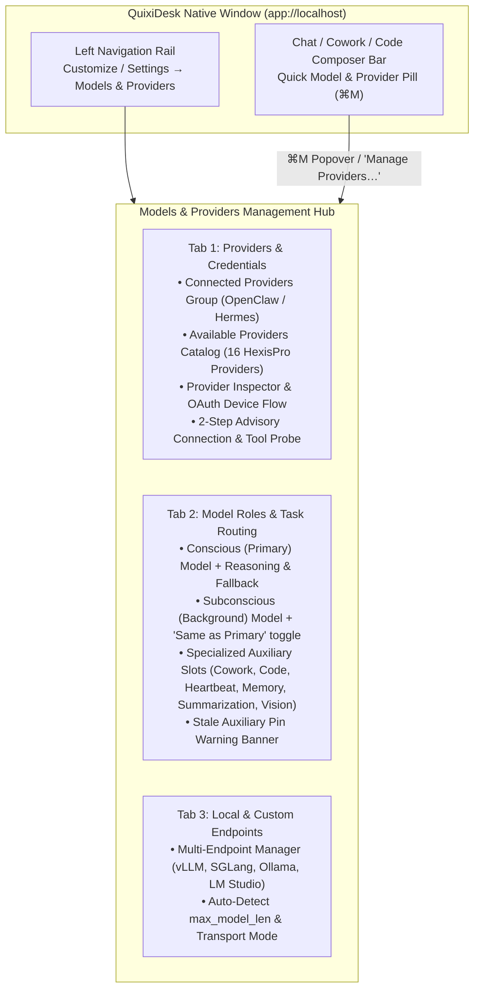

# QuixiDesk — LLM Provider & Model Management UI Design

This specification defines the UI and native Rust backend architecture for managing LLM providers, credentials, OAuth subscriptions, model catalogs, and role-based routing in **QuixiDesk**, synthesizing:
1. **HexisPro** ([`models-stage.tsx`](file:///Users/eric/hexispro/hexis-ui/app/init/stages/models-stage.tsx), [`oauth-control.tsx`](file:///Users/eric/hexispro/hexis-ui/app/init/oauth-control.tsx), [`core/llm.py`](file:///Users/eric/hexispro/core/llm.py), [`core/init_api.py`](file:///Users/eric/hexispro/core/init_api.py), [`settings/page.tsx`](file:///Users/eric/hexispro/hexis-ui/app/settings/page.tsx))
2. **Hermes Agent** ([`providers-settings.tsx`](file:///Users/eric/hexispro/.reference/hermes-agent/apps/desktop/src/app/settings/providers-settings.tsx), [`model-settings.tsx`](file:///Users/eric/hexispro/.reference/hermes-agent/apps/desktop/src/app/settings/model-settings.tsx), [`custom-endpoints-settings.tsx`](file:///Users/eric/hexispro/.reference/hermes-agent/apps/desktop/src/app/settings/custom-endpoints-settings.tsx), [`modelPicker.tsx`](file:///Users/eric/hexispro/.reference/hermes-agent/ui-tui/src/components/modelPicker.tsx))
3. **OpenClaw** ([`provider-row.tsx`](file:///Users/eric/hexispro/.reference/openclaw/ui/src/pages/model-providers/provider-row.tsx), [`default-models-view.tsx`](file:///Users/eric/hexispro/.reference/openclaw/ui/src/pages/model-providers/default-models-view.tsx), [`login-view.tsx`](file:///Users/eric/hexispro/.reference/openclaw/ui/src/pages/model-providers/login-view.tsx))

---

## 1. First-Load Onboarding Gate & Priority Provider Ordering

### 1.1 First-Load Onboarding Gate (`provider_ui.js` + `providers.rs`)
- **Initial Boot Check (`GET /api/quixi/providers`):**
  - When QuixiDesk first loads, before entering `/new`, it checks `~/.quixi/providers.json`.
  - **If no providers are configured (`!hasConfiguredProvider || !onboardingCompleted`):** QuixiDesk immediately displays the full-screen **LLM Provider Configuration** screen (`#quixi-provider-overlay`), because QuixiDesk requires at least one configured LLM provider to operate.
  - **Once configured (`hasConfiguredProvider && onboardingCompleted`):** QuixiDesk opens directly into the main workspace interface (`/new`, `/cowork/...`, `/epitaxy`) and renders a compact status pill (`#quixi-provider-pill`, or shortcut `Cmd+Shift+P`) in the top-right header so the user can manage providers or switch models at any time.

### 1.2 Priority Provider Ordering
The provider list is ordered explicitly by versatility and authentication convenience:
1. **`#1` OpenRouter (`openrouter`)** — *First on the list (Recommended)*: Unified API gateway to 200+ frontier models (Claude Sonnet/Opus 4.6, GPT-5.4, Grok 4, Gemini 3.1 Pro, DeepSeek V4.1 Flash) with a single API key (`sk-or-v1-...`).
2. **`#2` Custom Endpoint (`custom`)** — *Second on the list*: Any OpenAI-compatible (`/v1/chat/completions`) or Anthropic-compatible (`/v1/messages`) base URL, optional API key, custom model IDs, and custom context window.
3. **`#3` OpenAI (`openai` / `openai-codex`)** — *Third on the list (Supports OAuth)*: 1-click **ChatGPT Plus/Pro Subscription Sign-In (Codex OAuth)** via RFC 8628 Device Code + PKCE browser flow, or OpenAI Platform API key (`sk-proj-...`).
4. **`#4` Grok / xAI (`xai` / `xai-oauth`)** — *Fourth on the list (Supports OAuth)*: 1-click **SuperGrok / X Account Sign-In (OAuth)** via xAI RFC 8628 Device Code flow, or xAI Console API key (`xai-...`).
5. **`#5` Anthropic (`anthropic`)** — *Fifth on the list (API Key Only)*: Direct Claude API access via Anthropic Console API key (`sk-ant-api03-...`; does not support consumer OAuth).
6. **`#6–#19` Remaining HexisPro Cloud & Local Providers**: `Google Gemini`, `DeepSeek`, `Groq`, `Mistral AI`, `MiniMax`, `Zhipu / GLM`, `Moonshot / Kimi`, `Cohere`, `Together AI`, `Fireworks AI`, plus 1-click local port auto-detection for `Ollama (:11434)`, `LM Studio (:1234)`, `vLLM (:8000)`, and `llama.cpp (:8080)`.

---

## 2. Complete Provider Matrix (100% Parity with `/Users/eric/hexispro`)

QuixiDesk supports all **16 `LlmProvider` slugs** from [`models-stage.tsx`](file:///Users/eric/hexispro/hexis-ui/app/init/stages/models-stage.tsx#L8-L24), organized into **14 user-facing provider cards** where subscription sign-ins (`openai-codex` and `xai-oauth`) are embedded directly inside their parent provider's form (`openai` and `grok`), matching `ACCOUNT_PROVIDER` / `ACCOUNT_OF` in HexisPro:

| # | Provider Slug (`LlmProvider`) | Parent / Account Mapping | Display Label | Auth Mode & Env Fallback | Default / Selectable Endpoints & Special Fields | Example Model ID |
| :- | :--- | :--- | :--- | :--- | :--- | :--- |
| 1 | `openai` | Parent of `openai-codex` | **OpenAI** | API Key (`OPENAI_API_KEY`) or switch to `openai-codex` | `https://api.openai.com/v1` | `gpt-5.4` / `gpt-4o` |
| 2 | `openai-codex` | `ACCOUNT_OF.openai` | **Codex (ChatGPT Subscription)** | RFC 8628 Device Code (`auth.openai.com/codex/device`) + PKCE Browser Redirect URL fallback (`http://localhost:1455/auth/callback`) | `https://chatgpt.com/backend-api` (Models via `/codex/models?client_version=1.0.0`) | `gpt-5.4` / `gpt-5.3-codex` |
| 3 | `anthropic` | Direct | **Anthropic** | API Key (`ANTHROPIC_API_KEY`) or Claude OAuth session | `https://api.anthropic.com` | `claude-sonnet-4-6` |
| 4 | `gemini` | Direct | **Google Gemini** | API Key (`GEMINI_API_KEY`) | `https://generativelanguage.googleapis.com` | `gemini-2.5-pro` |
| 5 | `grok` | Parent of `xai-oauth` | **Grok (xAI)** | API Key (`XAI_API_KEY`) or switch to `xai-oauth` | `https://api.x.ai/v1` | `grok-4` |
| 6 | `xai-oauth` | `ACCOUNT_OF.grok` | **Grok (SuperGrok / X OAuth)** | RFC 8628 Device Code via `https://auth.x.ai/.well-known/openid-configuration` (Client `b1a00492-073a-47ea-816f-4c329264a828`) | `https://api.x.ai/v1` | `grok-4` |
| 7 | `azure_openai` | Direct | **Azure OpenAI** | API Key (`AZURE_OPENAI_API_KEY`, sent via `api-key` HTTP header) | **Azure Resource Endpoint** (`https://<resource>.openai.azure.com` → normalized to `/openai/v1`) + **Deployment Name** (`model`) | `<deployment-name>` |
| 8 | `bedrock` | Direct | **Amazon Bedrock** | Optional Bedrock API Key (`AWS_BEARER_TOKEN_BEDROCK`) or host IAM / `AWS_*` env credentials | **AWS Region** (`endpoint`, default `ap-northeast-1`) | `jp.anthropic.claude-sonnet-4-5-20250929-v1:0` |
| 9 | `vertex` | Direct | **Google Vertex AI** | Optional **Service Account JSON Key** or host ADC (`GOOGLE_APPLICATION_CREDENTIALS`) | Split **Google Cloud Project ID** + **Region** (`default: asia-northeast1`), stored as `projects/<project>/locations/<location>` | `gemini-2.5-pro` / `claude-sonnet-4-5@20250929` |
| 10 | `openrouter` | Direct | **OpenRouter** | API Key (`OPENROUTER_API_KEY`) | `https://openrouter.ai/api/v1` | `anthropic/claude-sonnet-4.5` |
| 11 | `zai` | Direct | **Z.ai (GLM)** | API Key (`ZAI_API_KEY`) | **Plan & Region Selector (`ENDPOINT_OPTIONS.zai`)**: • Global (pay as you go): `https://api.z.ai/api/paas/v4` • GLM Coding Plan (Global): `https://api.z.ai/api/coding/paas/v4` • China (pay as you go): `https://open.bigmodel.cn/api/paas/v4` • GLM Coding Plan (China): `https://open.bigmodel.cn/api/coding/paas/v4` | `glm-5.3` |
| 12 | `deepseek` | Direct | **DeepSeek** | API Key (`DEEPSEEK_API_KEY`) | `https://api.deepseek.com` | `deepseek-v4-pro` |
| 13 | `qwen` | Direct | **Alibaba Qwen** | API Key (`DASHSCOPE_API_KEY`) | **Region Selector (`ENDPOINT_OPTIONS.qwen`)**: • International (Singapore): `https://dashscope-intl.aliyuncs.com/compatible-mode/v1` • Mainland China (Beijing): `https://dashscope.aliyuncs.com/compatible-mode/v1` | `qwen3.8-max` |
| 14 | `qwen_coding` | Direct | **Alibaba Qwen Coding Plan** | API Key (`QWEN_API_KEY`) | **Region Selector (`ENDPOINT_OPTIONS.qwen_coding`)**: • International (Singapore): `https://coding-intl.dashscope.aliyuncs.com/v1` • Mainland China (Beijing): `https://coding.dashscope.aliyuncs.com/v1` | `qwen3-coder-plus` |
| 15 | `meta` | Direct | **Meta Muse** | API Key (`META_API_KEY`) | `https://api.meta.ai/v1` | `muse-spark-1.3` |
| 16 | `openai_compatible` | Direct | **Local / Custom** | Optional API Key (`OPENAI_API_KEY`) | **Custom Endpoint URL** (`http://localhost:8000/v1`, `http://localhost:11434/v1`) + **Context length / `max-model-len`** (auto-filled from `/v1/models`) + **Accepts images (`supports_images`)** checkbox | Auto-discovered via `/v1/models` |

---

## 2. UI Architecture & Surfaces

### Surface 1: Providers & Credentials Inspector (`Tab 1`)
Combines **OpenClaw's `ProviderRow`**, **Hermes Agent's `ProvidersSettings`**, and **HexisPro's `ModelsStage` + `OAuthControl`**:
1. **Two-Column Master-Detail Layout (or Expandable Cards on Narrow Viewports):**
   - **Left Column (`Provider Catalog`)**:
     - Search filter input (`Filter providers by name, slug, or env var…`).
     - **Connected Providers** group pinned at the top with green status dot, active model pill, model count badge (`6 models`), and credential source badge (`OAuth ✓`, `Keychain`, `Env`).
     - **Available Providers** group below listing all remaining HexisPro providers.
   - **Right Column (`Provider Configuration Inspector`)**:
     - **Dual Auth Switcher (for `openai` ↔ `openai-codex` and `grok` ↔ `xai-oauth`)**:
       - Segmented control switching between **Subscription Sign-In (`OAuthControl`)** and **API Key**.
       - When **Subscription Sign-In** is clicked: requests a one-time RFC 8628 device code (`XXXX-XXXX`), displays it in large monospace type with a **`Copy code and open OpenAI / xAI`** button, polls every `interval` seconds in the background, and (for OpenAI Codex) automatically offers the **Browser Redirect URL Paste** fallback if device-code issuance is unavailable.
     - **Provider-Specific Dynamic Fields**:
       - `zai`, `qwen`, `qwen_coding`: **Plan & Region** `<select>` dropdown (`ENDPOINT_OPTIONS`).
       - `vertex`: Split **Google Cloud Project ID** + **Region** (`asia-northeast1`) inputs that serialize into `projects/<project>/locations/<location>`, plus optional **Service Account JSON Key**.
       - `bedrock`: **AWS Region** input (`ap-northeast-1`) + optional **Bedrock API Key** (`AWS_BEARER_TOKEN_BEDROCK`) with IAM/env fallback hint.
       - `azure_openai`: **Azure OpenAI Resource Endpoint** (`https://<resource>.openai.azure.com`) + **Deployment Name** (`model`).
       - `openai_compatible`: **Endpoint URL** (`http://localhost:8000/v1`) + **Context length / `max-model-len`** (auto-populated when a model from `/v1/models` reports `max_model_len`) + **Accepts images (`supports_images`)** checkbox.
     - **Credential Key Source Indicator**:
       - Explicitly tells the user where the credential comes from (`keySource`: `"oauth"`, `"stored"` in OS Keychain / `~/.quixi/auth.json`, `"env"` from `$OPENAI_API_KEY` / `$ANTHROPIC_API_KEY` / etc., or `"typed"`), matching HexisPro's `keyHint()`.
     - **Live Model Datalist & Discovery**:
       - Queries `/api/quixi/providers/models` on provider/endpoint/key blur (with request deduplication like `lastRequest.current` in HexisPro) and populates both a clickable chip list and an `<input list="...">` combobox so users can either pick a discovered model or type any custom model ID.
     - **Advisory 2-Step Connection & Tool-Calling Probe (`Test Connection`)**:
       - Mirrors `test_llm_connection()` in [`core/init_api.py`](file:///Users/eric/hexispro/core/init_api.py#L75-L138):
         - **Step 1 (Completion Probe)**: Sends `"Reply with just the word: ok"` (`temperature: null, max_tokens: 1024`).
         - **Step 2 (Tool-Calling Probe)**: Sends `'Call the record_check tool with result "ok".'` with `_CHECK_TOOL` schema.
       - Classifies any error via `classify_llm_error()` into `ok`, `auth`, `billing`, `rate_limit`, `model`, `network`, `config`, `empty`, or `tools` (warning when a model replies with text but cannot invoke tools).

### Surface 2: Model Roles & Task Routing (`Tab 2`)
Combines **HexisPro's Conscious / Subconscious & 6 Role Slots** with **Hermes Agent's Auxiliary Task Routing** and **OpenClaw's Default Models**:
1. **Conscious (Primary) Model Card (`llm.chat`)**:
   - Provider + Model selector for primary interactive decisions, chat replies, and tool execution.
   - **Reasoning Effort** segmented control (`Low`, `Medium`, `High`, `Off`) and **Fallback Model** selector (for automatic failover on `429`/`5xx`).
2. **Subconscious (Background / Utility) Model Card (`llm.subconscious`)**:
   - Includes HexisPro's **`"Use the conscious model for the subconscious too"`** checkbox (`sameAsPrimary`).
   - When unchecked, reveals a separate Provider + Model picker for high-frequency background work (context appraisal, memory extraction, title generation).
3. **Specialized Task Slots Table**:
   - Supports pinning or inheriting (`auto · follows Primary` / `auto · follows Subconscious`) across all HexisPro & QuixiDesk roles:
     - `llm.chat` — Primary Chat & Cowork Interactive Turns
     - `llm.cowork` — Cowork Autonomous Multi-Step Agent
     - `llm.code` — Code Tab & Repository Diff Sessions
     - `llm.heartbeat` — Scheduled Tasks & Autonomous Heartbeats
     - `llm.recmem` — Cowork Memory Extraction & Retrieval
     - `llm.summarization` — Transcript Compression & Summarization
     - `llm.skill_improvement` — Skill Authoring & Refinement
     - `llm.vision` — Computer Use & Screen Coordinate Grounding
4. **Stale Auxiliary Pin Warning Banner (Hermes Agent Pattern)**:
   - When the user switches the Primary (`conscious`) provider while an auxiliary slot is still pinned to a different paid provider (excluding local/LAN endpoints), displays a prominent amber banner with a 1-click **`Reset all to Primary`** button.

### Surface 3: Composer Quick-Switcher Popover (`Tab 3` / `⌘M`)
- Accessible directly from the model pill in the Chat / Cowork / Code composer bar or via `⌘M`.
- Instant fuzzy filter across all 16 providers and their models.
- Inline API key prompt if the user selects an unconfigured provider directly from the composer.
- Footer toggle for **Reasoning Effort** (`Low` / `Med` / `High` / `Off`) and **Persistence Scope** (`Global Default` vs `This Session Only`).
