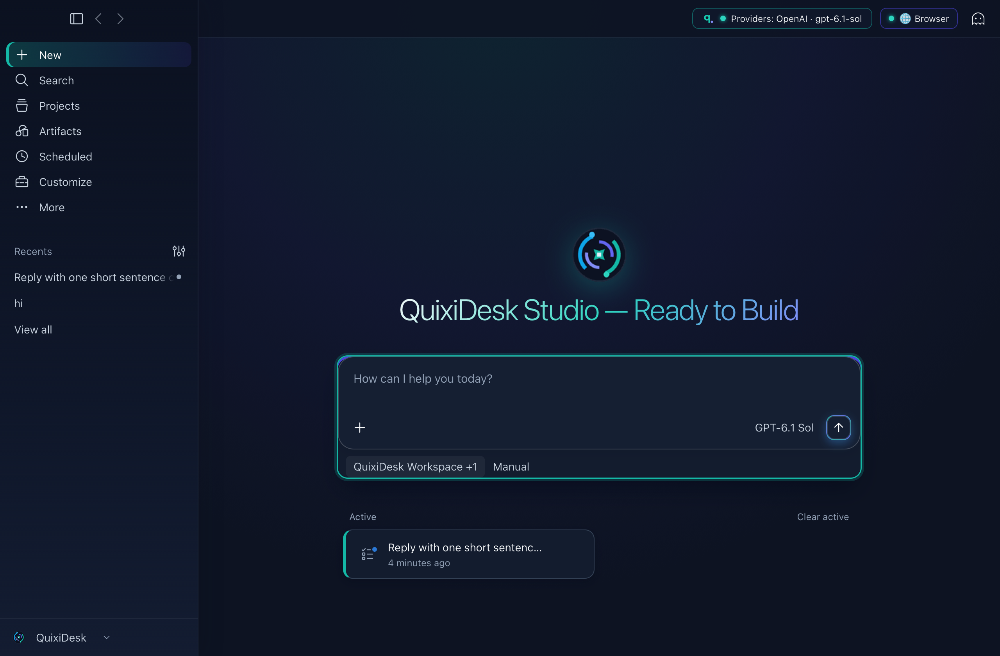
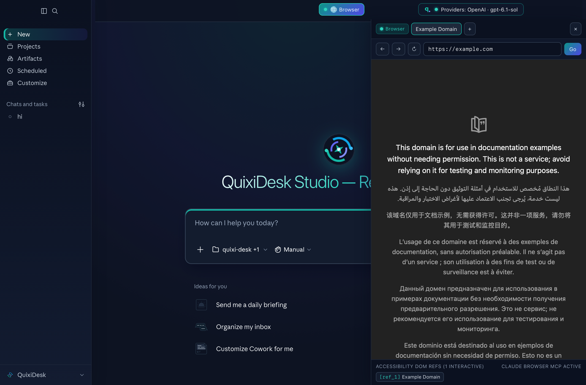

<div align="center">


# QuixiDesk

**A Native Rust, Open-Source Alternative to Claude Desktop**

[](LICENSE)
[](Cargo.toml)
[](https://github.com/morluto/rea)
[](https://madewithrea.com/builds/quixidesk-native-rust-rebuild-of-claude-desktop-mapped-with-rea)

</div>

---

**QuixiDesk** is a fast, native Rust (`tao` + `wry` `WKWebView`) open-source alternative to **Claude Desktop**. It replaces the heavy Electron + Node.js runtime with a single-process native Rust workspace engine while preserving full feature parity—and extending it with **17 pluggable LLM providers**, **zero-configuration built-in MCPs (In-App Browser Use & Computer Use)**, a **unified task/chat workspace**, and **11 UI languages** out of the box.

## Screenshots

### Unified Workspace Home


### Docked In-App Browser Use & Accessibility DOM Inspector


---

## Appreciation & Credit: [REA (`morluto/rea`)](https://github.com/morluto/rea)

Special appreciation goes to **[REA — Reverse Engineer Anything (`github.com/morluto/rea`)](https://github.com/morluto/rea)**.

QuixiDesk's architectural reconstruction—mapping 1,400+ IPC channels, native macOS helper protocols (`computer-use`, `browser-use`, `chrome-native-host`, `ssh-askpass`, `disclaimer`, `guest-daemon`), custom `app://` protocol handlers, and real-time streaming state stores into a clean 10-crate native Rust workspace—was made possible by **[REA](https://github.com/morluto/rea)**. If you are analyzing native binaries, Electron/JavaScript bundles, mobile packages, or complex runtime protocols, check out and star **[https://github.com/morluto/rea](https://github.com/morluto/rea)**.

---

## Key Features

- **Native Rust Runtime (Zero Electron / Node.js Overhead):** Built on `tao` + `wry` with a custom `app://localhost` protocol router (`quixi-app`, `quixi-ipc`, `quixi-engine`, `quixi-workspace`, `quixi-platform`, `quixi-mcp`, `quixi-netstack`).
- **Unified Workspace Experience:** No artificial "Chat vs. Cowork vs. Code" mode walls—attach local workspace folders, grant or restrict file modification permissions on the fly, and run multi-turn streaming sessions in one unified view.
- **Built-In In-App Browser Use & Computer Use (Out of the Box):**
  - **In-App Browser (`Claude Browser` & `Claude in Chrome`):** Opens a docked browser pane right inside QuixiDesk with multi-tab navigation, live DOM rendering, and interactive `[ref_N]` accessibility element inspection.
  - **Computer Use:** Native macOS CoreGraphics screen capture, cursor control, keyboard/mouse synthesis, and window inspection (`44` tools active out of the box).
  - **Pre-Bundled Workspace & Productivity MCPs:** Includes `quixi-workspace` (file index, git pool, shell host), `applescript`, `pdf`, `memory`, `fetch`, `github`, `office365`, `Framebuffer`, `visualize`, and `scheduled-tasks` pre-configured with zero manual setup.
- **11 Built-In UI Languages:** Switch seamlessly between English (`en-US`), Français (`fr-FR`), Deutsch (`de-DE`), Español (`es-ES` / `es-419`), 日本語 (`ja-JP`), 한국어 (`ko-KR`), Italiano (`it-IT`), Português (`pt-BR`), हिन्दी (`hi-IN`), and Bahasa Indonesia (`id-ID`).

---

## Supported LLM Providers

QuixiDesk includes a built-in **Provider Manager** (`⌘⇧P` or click the top-right **Providers** pill) supporting **17 cloud, OAuth, and local inference providers**:

### Priority Providers
| # | Provider | Auth Modes | Default / Example Models |
| :--- | :--- | :--- | :--- |
| **1** | **OpenRouter** *(Recommended)* | API Key (`OPENROUTER_API_KEY`) | `anthropic/claude-sonnet-4.6`, `anthropic/claude-opus-4.6`, `openai/gpt-5.4`, `google/gemini-3.1-pro`, `deepseek/deepseek-v4.1-flash`, `x-ai/grok-4` |
| **2** | **Custom OpenAI-Compatible** | API Key / Optional (`CUSTOM_LLM_API_KEY`) | Any OpenAI `/v1/chat/completions` endpoint (vLLM, LiteLLM, TabbyAPI, proxies) |
| **3** | **OpenAI (ChatGPT Plus / Pro & API)** | **PKCE / Device OAuth** or API Key (`OPENAI_API_KEY`) | `gpt-5.4`, `gpt-5.4-mini`, `o3`, `o4-mini`, `gpt-4.1` |
| **4** | **xAI Grok (SuperGrok / X & API)** | **RFC 8628 Device OAuth** or API Key (`XAI_API_KEY`) | `grok-4`, `grok-3`, `grok-3-mini`, `grok-code-fast-1` |
| **5** | **Anthropic (Claude Direct)** | API Key (`ANTHROPIC_API_KEY`) | `claude-sonnet-4-6`, `claude-opus-4-6`, `claude-haiku-4-5-20251001` |

### Cloud Providers
| Provider | Environment Variable | Base Endpoint | Example Models |
| :--- | :--- | :--- | :--- |
| **Google Gemini** | `GEMINI_API_KEY` | `https://generativelanguage.googleapis.com/v1beta/openai` | `gemini-2.5-pro`, `gemini-2.5-flash` |
| **DeepSeek** | `DEEPSEEK_API_KEY` | `https://api.deepseek.com/v1` | `deepseek-flash` (V4.1 Flash, 1M ctx, vision), `deepseek-v4-pro` |
| **Groq** | `GROQ_API_KEY` | `https://api.groq.com/openai/v1` | `llama-3.3-70b-versatile`, `deepseek-r1-distill-llama-70b`, `qwen-qwq-32b` |
| **Mistral AI** | `MISTRAL_API_KEY` | `https://api.mistral.ai/v1` | `mistral-large-latest`, `codestral-latest` |
| **Together AI** | `TOGETHER_API_KEY` | `https://api.together.xyz/v1` | `meta-llama/Llama-3.3-70B-Instruct-Turbo`, `deepseek-ai/DeepSeek-R1` |
| **Fireworks AI** | `FIREWORKS_API_KEY` | `https://api.fireworks.ai/inference/v1` | `accounts/fireworks/models/deepseek-v3`, `llama-v3p3-70b-instruct` |
| **Perplexity** | `PERPLEXITY_API_KEY` | `https://api.perplexity.ai` | `sonar-pro`, `sonar-reasoning-pro`, `sonar` |
| **Cohere** | `COHERE_API_KEY` | `https://api.cohere.com/compatibility/v1` | `command-a-03-2025`, `command-r-plus-08-2024` |
| **Cerebras** | `CEREBRAS_API_KEY` | `https://api.cerebras.ai/v1` | `llama-3.3-70b`, `qwen-3-32b` |

### Local Zero-Key Providers (Auto-Detected)
| Provider | Default Local Endpoint | Example Models |
| :--- | :--- | :--- |
| **Ollama (Local)** | `http://127.0.0.1:11434/v1` | `qwen3:32b`, `llama3.3:latest`, `deepseek-r1:32b`, `gemma3:27b` |
| **LM Studio (Local)** | `http://127.0.0.1:1234/v1` | Any GGUF / MLX model loaded in LM Studio |
| **llama.cpp / LocalAI** | `http://127.0.0.1:8080/v1` | Any model served by `llama-server` or LocalAI |

---

## Installation & Build Instructions

The IPC response defaults are checked in at `crates/quixi-ipc/ipc-exact-schemas.json`.
Normal builds do not require the ignored `reference/` or `asar-extracted/` directories.
`scripts/generate-exact-ipc-schemas.js` is a maintainer tool that updates this snapshot;
it requires the extracted JavaScript bundle and `reference/ipc-return-validators.json`.

### Prerequisites
- **macOS 14.0 (Sonoma) or later** (Apple Silicon or Intel)
- **Rust Toolchain** (`rustup`, `cargo` 1.80+)
- **Xcode Command Line Tools** (`xcode-select --install`)

### 1. Clone the Repository
```bash
git clone git@github.com:QuixiAI/QuixiDesk.git
cd QuixiDesk
```

### 2. Run the Test Suite
Verify all 10 workspace crates (`quixi-proto`, `quixi-workspace`, `quixi-platform`, `quixi-mcp`, `quixi-netstack`, `quixi-engine`, `quixi-ipc`, `quixi-app`, `quixi-guest-daemon`, and native helpers):
```bash
cargo test --workspace
```

The [E2E test suite design](docs/testing/E2E_TEST_PLAN.md) defines the proposed packaged-app tests, fixtures, isolation requirements, and CI rollout. It is a design specification; the E2E runner is not implemented yet.
The [Claude desktop UI exploration](docs/testing/CLAUDE_UI_EXPLORATION.md) records the reference controls inspected through computer use and the additional cases they informed.

### 3. Build & Package `QuixiDesk.app`
Build the optimized release binaries and package a self-contained macOS application bundle into `dist/QuixiDesk.app`:
```bash
cargo build --release --workspace
./scripts/package-macos-app.sh      # or simply: make app
```
The bundle is relocatable (resources are copied, not symlinked), ad-hoc codesigned, and can be moved to `/Applications`. Use `make install` to do that in one step, or `QUIXI_APP_SYMLINK_RESOURCES=1 make app` for a fast iteration loop that symlinks `resources/` instead.

> **Workspace folder:** the engine opens the source checkout by default. Point it anywhere else with `QUIXI_WORKSPACE=/path/to/folder`. All path defaults live in `crates/quixi-proto/src/paths.rs` — no machine-specific paths are baked in.
>

Or run the desktop app directly in release mode:
```bash
cargo run --release -p quixi-app
```

### 4. Launch `QuixiDesk.app`
```bash
open dist/QuixiDesk.app
```
Optionally copy `dist/QuixiDesk.app` into `/Applications`:
```bash
cp -R dist/QuixiDesk.app /Applications/
```

---

## Workspace Architecture

```text
QuixiDesk/
├── crates/
│   ├── quixi-app/        # Native tao + wry WKWebView shell, custom app:// protocol & UI overlay
│   ├── quixi-ipc/        # EIPC router implementing 1,400+ desktop service & store channels
│   ├── quixi-engine/     # Session orchestrator, multi-provider LLM router & streaming engine
│   ├── quixi-mcp/        # Built-in MCP host (Computer Use, Browser Use, Workspace, AppleScript, PDF, Memory)
│   ├── quixi-platform/   # macOS CoreGraphics Computer Use, In-App Browser Use & SafeFS sandbox
│   ├── quixi-workspace/  # Native file indexer, git pool engine, transcript search & PTY shell host
│   ├── quixi-netstack/   # Egress policy & credential management
│   ├── quixi-proto/      # Shared EIPC protocol types and channel parser
│   └── quixi-guest-daemon/ # VM guest vsock/virtio daemon
├── bins/
│   ├── quixi-mcp-builtin/        # Standalone stdio MCP server (--computer-use / --browser-use)
│   ├── quixi-chrome-native-host/ # Native messaging host for browser extension bridge
│   ├── quixi-disclaimer/         # TCC permission disclaimer helper
│   └── quixi-ssh-askpass/        # Native SSH askpass helper
└── resources/            # Bundled UI assets, 11-locale i18n catalogs, preload bridge & skills
```

---

## License

Released under the **[MIT License](LICENSE)**.
