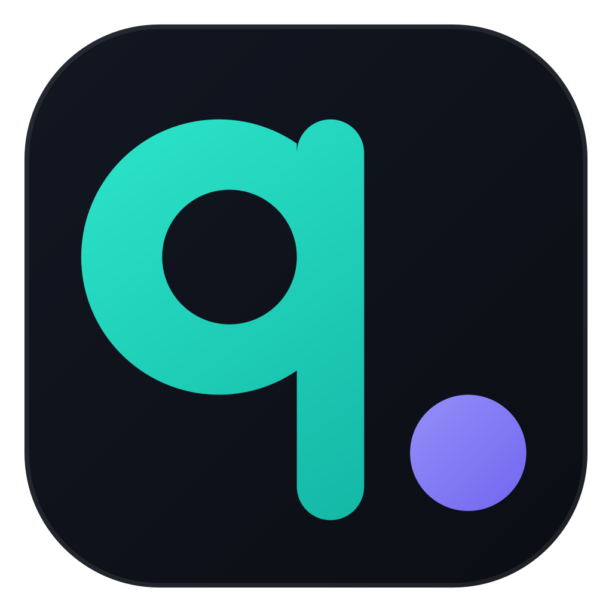
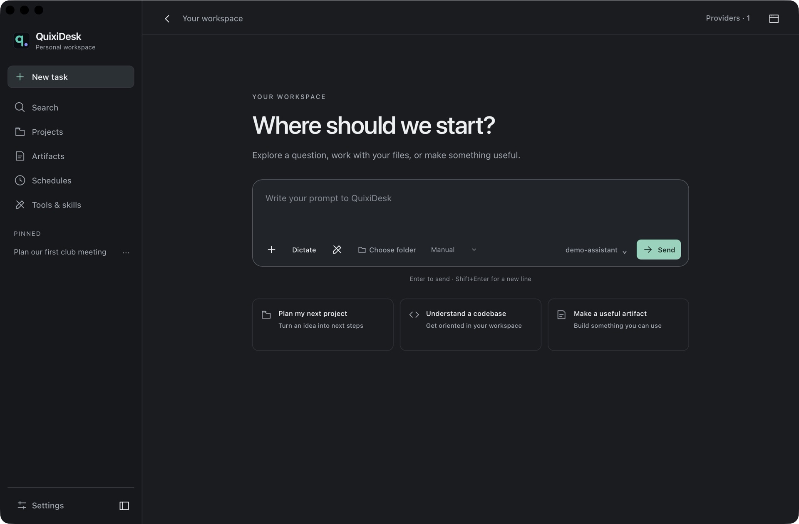
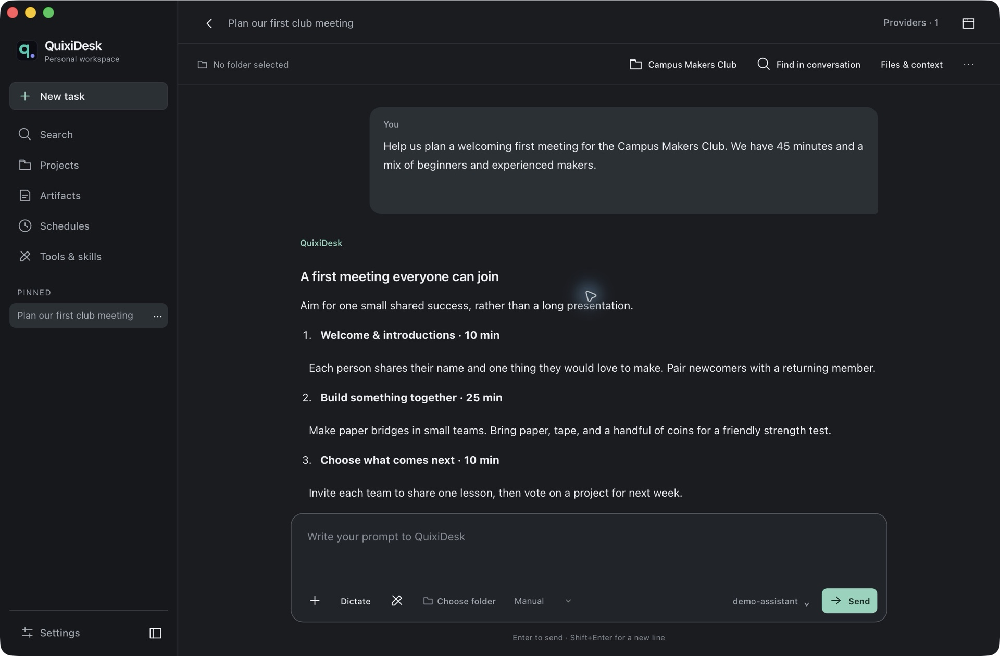
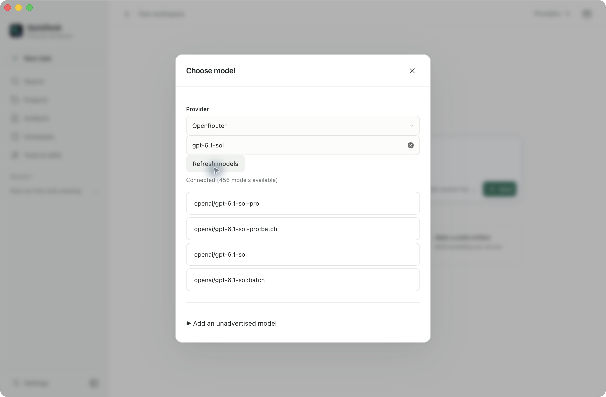

<div align="center">



# QuixiDesk

**A Native Rust Desktop Workspace for AI**

[](LICENSE)
[](Cargo.toml)
[](https://github.com/morluto/rea)

</div>

---

**QuixiDesk** is a native Rust (`tao` + `wry`) desktop workspace with **pluggable LLM providers**, **built-in MCP tools**, and a **unified task/chat workspace**. Its native host runs without an Electron or Node.js application runtime.

## Screenshots

Current macOS interface, shown with a sample club-planning workspace.

### Start a task



### Work through a conversation



### Choose a model



---

## Appreciation & Credit: [REA (`morluto/rea`)](https://github.com/morluto/rea)

Special appreciation goes to **[REA — Reverse Engineer Anything (`github.com/morluto/rea`)](https://github.com/morluto/rea)**.

The native runtime development and analysis benefited from **[REA](https://github.com/morluto/rea)**. If you are analyzing native binaries, Electron/JavaScript bundles, mobile packages, or complex runtime protocols, check out and star **[https://github.com/morluto/rea](https://github.com/morluto/rea)**.

---

## Key Features

- **Native Rust Runtime (Zero Electron / Node.js Overhead):** Built on `tao` + `wry` with a custom `app://localhost` protocol router (`quixi-app`, `quixi-ipc`, `quixi-engine`, `quixi-workspace`, `quixi-platform`, `quixi-mcp`, `quixi-netstack`).
- **Unified Workspace:** Attach local folders, choose file modification permissions, and run multi-turn streaming sessions in one view.
- **Built-In In-App Browser Use & Computer Use (Out of the Box):**
  - **In-App Browser:** Opens a docked browser pane inside QuixiDesk with multi-tab navigation, isolated page snapshots, and interactive `[ref_N]` accessibility element inspection.
  - **Computer Use:** Native macOS CoreGraphics screen capture, cursor control, keyboard/mouse synthesis, and window inspection (`44` tools active out of the box).
  - **Pre-Bundled Workspace & Productivity MCPs:** Includes `quixi-workspace` (file index, git pool, shell host), `applescript`, `pdf`, `memory`, `fetch`, `github`, `office365`, `Framebuffer`, `visualize`, and `scheduled-tasks` pre-configured with zero manual setup.
- **Original Interface:** System typography, light and dark themes, keyboard navigation, and responsive layouts. The replacement interface currently uses English.

Select a workspace folder before sending a file task. **Manual** allows directory listings and file reads, then pauses for approval before changes or commands. **Allow once** approves the displayed action; **Allow file edits** permits edits in that conversation while commands continue to ask. **Auto** permits tool actions without individual approval. Approving an action resumes the current request.

In a project, **Add folder** opens the native folder chooser. **Enter path** also accepts home-folder shortcuts such as `~/Projects/my-project`, paths with spaces, and quoted paths copied from your file manager.

Tool calls and their results appear together in a collapsible activity group. **Stop** cancels pending approvals and preserves any answer text already received. Follow-up requests retain earlier tool results, and artifact revisions can update the existing preview without changing its link.

---

## Supported LLM Providers

QuixiDesk includes a built-in **Provider Manager** (open **Settings → Providers**) supporting **cloud, OAuth, and local inference providers**:

Configure the endpoint and credentials, then save. QuixiDesk loads all models advertised by the provider's `/models` endpoint; no model ID is required during setup. Use the chat model picker to search, select, or refresh the catalog. Custom Endpoint and OpenRouter also support adding exact IDs for unadvertised models without replacing the discovered list.

### Priority Providers
| # | Provider | Auth Modes | Default / Example Models |
| :--- | :--- | :--- | :--- |
| **1** | **OpenRouter** *(Recommended)* | API Key (`OPENROUTER_API_KEY`) | `openai/gpt-5.4`, `google/gemini-3.1-pro`, `deepseek/deepseek-v4.1-flash`, `x-ai/grok-4` |
| **2** | **Custom OpenAI-Compatible** | API Key / Optional (`CUSTOM_LLM_API_KEY`) | Any OpenAI `/v1/chat/completions` endpoint (vLLM, LiteLLM, TabbyAPI, proxies) |
| **3** | **OpenAI (ChatGPT Plus / Pro & API)** | **PKCE / Device OAuth** or API Key (`OPENAI_API_KEY`) | `gpt-5.4`, `gpt-5.4-mini`, `o3`, `o4-mini`, `gpt-4.1` |
| **4** | **xAI Grok (SuperGrok / X & API)** | **RFC 8628 Device OAuth** or API Key (`XAI_API_KEY`) | `grok-4`, `grok-3`, `grok-3-mini`, `grok-code-fast-1` |
| **5** | **Anthropic (Claude Direct)** | API Key (`ANTHROPIC_API_KEY`) | `claude-sonnet-4-6`, `claude-opus-4-6`, `claude-haiku-4-5-20251001` |

### Cloud Providers
| Provider | Environment Variable | Base Endpoint | Example Models |
| :--- | :--- | :--- | :--- |
| **Google Gemini** | `GEMINI_API_KEY` | `https://generativelanguage.googleapis.com/v1beta/openai` | `gemini-2.5-pro`, `gemini-2.5-flash` |
| **DeepSeek** | `DEEPSEEK_API_KEY` | `https://api.deepseek.com/v1` | `deepseek-flash` (V4.1 Flash, 1M ctx, vision), `deepseek-v4-pro` |
| **Groq** | `GROQ_API_KEY` | `https://api.groq.com/openai/v1` | `llama-3.3-70b-versatile`, `deepseek-r1-distill-llama-70b`, `qwen-qwq-32b` |
| **Mistral AI** | `MISTRAL_API_KEY` | `https://api.mistral.ai/v1` | `mistral-large-latest`, `codestral-latest` |
| **Together AI** | `TOGETHER_API_KEY` | `https://api.together.xyz/v1` | `meta-llama/Llama-3.3-70B-Instruct-Turbo`, `deepseek-ai/DeepSeek-R1` |
| **Fireworks AI** | `FIREWORKS_API_KEY` | `https://api.fireworks.ai/inference/v1` | `accounts/fireworks/models/deepseek-v3`, `llama-v3p3-70b-instruct` |
| **Perplexity** | `PERPLEXITY_API_KEY` | `https://api.perplexity.ai` | `sonar-pro`, `sonar-reasoning-pro`, `sonar` |
| **Cohere** | `COHERE_API_KEY` | `https://api.cohere.com/compatibility/v1` | `command-a-03-2025`, `command-r-plus-08-2024` |
| **Cerebras** | `CEREBRAS_API_KEY` | `https://api.cerebras.ai/v1` | `llama-3.3-70b`, `qwen-3-32b` |

### Local Zero-Key Providers (Auto-Detected)
| Provider | Default Local Endpoint | Example Models |
| :--- | :--- | :--- |
| **Ollama (Local)** | `http://127.0.0.1:11434/v1` | `qwen3:32b`, `llama3.3:latest`, `deepseek-r1:32b`, `gemma3:27b` |
| **LM Studio (Local)** | `http://127.0.0.1:1234/v1` | Any GGUF / MLX model loaded in LM Studio |
| **llama.cpp / LocalAI** | `http://127.0.0.1:8080/v1` | Any model served by `llama-server` or LocalAI |

---

## Installation & Build Instructions

QuixiDesk uses the system webview: WKWebView on macOS, WebKitGTK on Linux, and WebView2 on Windows. Build on the target OS with the **current stable Rust toolchain** from [rustup](https://rust-lang.org/tools/install/) and Git. The lockfile is checked in; use `--locked` for reproducible dependency selection. Node.js and Electron are not required to build or run the checked-in application.

The original interface, bootstrap defaults, icons, and task instructions are checked in under `resources/`. Keep that directory with the application. Build directly from the repository; no extracted application bundle or external renderer is required. Regenerate the skill archives with `python3 scripts/package-bundled-skills.py` after editing their sources.

Clone using HTTPS (or your configured Git SSH credentials):

```sh
git clone https://github.com/QuixiAI/QuixiDesk.git
cd QuixiDesk
```

### macOS

Use macOS 14 or later for the documented build/test setup (Apple Silicon or Intel). Install Apple's command line tools and Rust:

```sh
xcode-select --install
curl --proto '=https' --tlsv1.2 -sSf https://sh.rustup.rs | sh
# Open a new terminal after installation, then enter the checkout.
rustup update stable
cargo build --locked --release --workspace
./target/release/QuixiDesk
```

To create a relocatable, ad-hoc signed app bundle:

```sh
./scripts/package-macos-app.sh
open dist/QuixiDesk.app
# Optional installation; quit any existing QuixiDesk instance first.
cp -R dist/QuixiDesk.app /Applications/
```

`make app` and `make install` are shortcuts for packaging and installation. `QUIXI_APP_SYMLINK_RESOURCES=1 make app` links resources for local iteration; use the default copied resources when distributing a bundle. Screen recording, Accessibility, and Automation access for native computer-use tools are granted through macOS System Settings when needed.

### Linux (Debian / Ubuntu)

Install the GTK 3 and WebKitGTK 4.1 development packages described by [Wry's platform notes](https://github.com/tauri-apps/wry#platform-specific-notes):

```sh
sudo apt update
sudo apt install build-essential pkg-config libgtk-3-dev libwebkit2gtk-4.1-dev curl git
curl --proto '=https' --tlsv1.2 -sSf https://sh.rustup.rs | sh
# Open a new terminal after installation, then enter the checkout.
rustup update stable
cargo build --locked --release --workspace
./target/release/QuixiDesk
```

Run from an active graphical login with a working session D-Bus and Wayland or X11 display. A plain SSH session without a display is insufficient for normal desktop use. For a dedicated X11 test display, set `GDK_BACKEND=x11`; GTK container construction supports both X11 and Wayland. Native build and isolated app tests have been exercised on Ubuntu 26.04 x86_64.

For a portable install, copy the executable, helpers, and resources together:

```sh
mkdir -p "$HOME/.local/opt/QuixiDesk"
cp target/release/QuixiDesk target/release/quixi-* "$HOME/.local/opt/QuixiDesk/"
cp -R resources "$HOME/.local/opt/QuixiDesk/resources"
QUIXI_RESOURCES_DIR="$HOME/.local/opt/QuixiDesk/resources" "$HOME/.local/opt/QuixiDesk/QuixiDesk"
```

The destination machine needs GTK 3 and WebKitGTK 4.1 runtime libraries. Build on a compatible Linux distribution; this is not a universal static binary or an AppImage.

### Windows 10 / 11 (native, PowerShell)

Install Git, [Rust for Windows](https://rust-lang.org/tools/install/), and [Visual Studio C++ Build Tools](https://rust-lang.github.io/rustup/installation/windows-msvc.html) with the **Desktop development with C++** workload and a Windows SDK. Use the MSVC Rust toolchain, not the GNU or WSL toolchain. Install the [Microsoft Edge WebView2 Evergreen Runtime](https://developer.microsoft.com/en-us/microsoft-edge/webview2/) if it is not already present. Reopen PowerShell after installation so Cargo and Git are on `PATH`.

From the checkout:

```powershell
rustup update stable-msvc
rustup default stable-msvc
cargo build --locked --release --workspace
.\target\release\QuixiDesk.exe
```

Use a Windows desktop session for normal app interaction. SSH can build and run automated storage tests, but does not provide an interactive desktop. Native shell tools use `cmd.exe` with AutoRun disabled; browser fetching uses Windows' `System32\curl.exe` (included in the tested Windows 10 22H2 installation).

For a portable install, copy the binaries and resources into a user-owned folder:

```powershell
$install = Join-Path $env:LOCALAPPDATA 'Programs\QuixiDesk'
New-Item -ItemType Directory -Force $install | Out-Null
Copy-Item .\target\release\*.exe $install
Copy-Item .\resources (Join-Path $install 'resources') -Recurse -Force
$env:QUIXI_RESOURCES_DIR = Join-Path $install 'resources'
& (Join-Path $install 'QuixiDesk.exe')
```

There is no MSI or Windows signing/installer workflow yet. Keep the resources directory available; `QUIXI_RESOURCES_DIR` explicitly selects it when launching outside the source checkout.

### Platform scope and configuration

Native CoreGraphics/AppleScript computer-use integration is macOS-specific. Linux and Windows builds do not currently provide the same native computer-use and folder-picker capabilities. Building the cross-platform shell does not imply full native-feature parity.

The engine opens the source checkout as its default workspace in development. Set `QUIXI_WORKSPACE` to an explicit folder to override it. `QUIXI_RESOURCES_DIR` overrides resource discovery. Normal app data is stored under the OS user's `.quixi` directory; test profiles below use a separate location. Configure a provider in the app after launch; no API credential is required to compile or run the tests.

### Tests and disposable account profiles

Run the workspace tests with a disposable app profile. On macOS/Linux:

```sh
QUIXI_TEST_PROFILE="$(mktemp -d)" cargo test --locked --workspace
./target/release/QuixiDesk --test-profile /tmp/quixi-qa-profile
# Optional complete account bootstrap fixture:
./target/release/QuixiDesk --test-profile /tmp/quixi-qa-profile --mock-account /absolute/path/mock-account.json
```

On Windows, preserve any existing test-profile setting while running tests:

```powershell
$previousProfile = $env:QUIXI_TEST_PROFILE
$env:QUIXI_TEST_PROFILE = Join-Path $env:TEMP ('quixi-unit-' + [guid]::NewGuid())
try { cargo test --locked --workspace } finally { $env:QUIXI_TEST_PROFILE = $previousProfile }
$profile = Join-Path $env:TEMP 'quixi-qa-profile'
.\target\release\QuixiDesk.exe --test-profile $profile
# Optional: append --mock-account C:\absolute\path\mock-account.json
```

The first profile launch creates `mock-account.json` with a synthetic account. Its `account` object requires a UUID and `memberships` array; `current_user_access` and `featureFlagsOrgUuid` can also be supplied. Providers start unconfigured and are saved separately. The profile contains `data/`, `home/`, `workspace/`, and independent web storage. `QUIXI_TEST_PROFILE` is the equivalent environment option for launching a separate test bundle. `QUIXI_AUTOMATION_PORT` selects its automation port (test default: 19456; normal default: 19455); use distinct ports for concurrent profiles. macOS test web-store isolation requires macOS 14+. This isolates app/account state, not OS permissions or tool filesystem/network access. No OS `HOME` override or real account credential copy is needed.

Conversation records are saved atomically. If the usual session folder is unavailable, QuixiDesk keeps a recovery snapshot under the app data directory's `recovery/` folder and restores it on restart. A persistent notice offers **Retry saving** and **Copy recovery data** for affected conversations. If both save locations fail, keep the app open: normal Quit and window close are blocked until a durable save succeeds. A force kill or power loss can still lose data held only in memory.

After building on Windows, run the targeted storage integration test:

```powershell
powershell -NoProfile -ExecutionPolicy Bypass -File .\scripts\test-windows-storage.ps1
```

It launches the native WebView2 app with a fresh profile, obstructs only fixture save paths, verifies recovery and restart, exercises **Retry saving**, and checks allowed/blocked native close events. It leaves its JSON results and logs in a newly created temporary directory and restores the caller's environment. This is an automated app-bridge test; manual desktop checks remain separate.

The original interface has a separate development-only Node.js test suite. Node.js is not needed by the production app:

```sh
npm ci --prefix tests/ui
npm test --prefix tests/ui
python3 scripts/audit-product-assets.py
```

The asset audit rejects imported branding and private font bundles and checks the integrity of redistributable artifact libraries and their licenses. The UI tests cover drafts, streaming, tool failures, project context, sandbox attributes, and concurrent updates; they do not replace native desktop or browser security testing.

Schedules can be saved and run manually; automatic dispatch is not currently implemented. The replacement interface currently uses English. Native desktop validation and the full E2E catalog remain separate from the automated regression checks.

On Linux, after a release build, run real WebKit frame isolation and navigation checks with `python3 scripts/test-linux-ui.py` (requires `xvfb-run`, `dbus-run-session`, and Python 3). It starts only a local fixture server and disposable profile and records its JSON results in a temporary directory. `--output` and `--port` select an evidence directory and unused automation port.

The [E2E test suite design](docs/testing/E2E_TEST_PLAN.md) defines the proposed full packaged-app suite, fixtures, isolation requirements, and CI rollout; its full runner is not implemented yet.

---

## Workspace Architecture

```text
QuixiDesk/
├── crates/
│   ├── quixi-app/        # Native tao + wry WKWebView shell, custom app:// protocol & original UI
│   ├── quixi-ipc/        # Desktop service and event router
│   ├── quixi-engine/     # Session orchestrator, multi-provider LLM router & streaming engine
│   ├── quixi-mcp/        # Built-in MCP host (Computer Use, Browser Use, Workspace, AppleScript, PDF, Memory)
│   ├── quixi-platform/   # macOS CoreGraphics Computer Use, In-App Browser Use & SafeFS sandbox
│   ├── quixi-workspace/  # Native file indexer, git pool engine, transcript search & PTY shell host
│   ├── quixi-netstack/   # Egress policy & credential management
│   ├── quixi-proto/      # Shared EIPC protocol types and channel parser
│   └── quixi-guest-daemon/ # VM guest vsock/virtio daemon
├── bins/
│   ├── quixi-mcp-builtin/        # Standalone stdio MCP server (--computer-use / --browser-use)
│   ├── quixi-chrome-native-host/ # Native messaging host for browser extension bridge
│   ├── quixi-disclaimer/         # TCC permission disclaimer helper
│   └── quixi-ssh-askpass/        # Native SSH askpass helper
└── resources/            # Bundled UI assets, original interface, bootstrap defaults, icons & skills
```

---

## License

Released under the **[MIT License](LICENSE)**.
